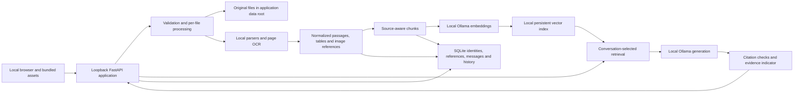

# Implementation Plan — Stage 1 Local Prototype

**Status:** Approved; T01–T03 and T05 complete, T04 explicitly deferred by the user. T05 closes with approved PyMuPDF empirical-comparison deferral. Format scope revised by the user to PDF/XLS/XLSX/CSV; downstream task revisions proposed for review; provisioning/adoption/implementation remain gated.

**Prepared:** 2026-11-13 (Asia/Calcutta).

**Requirements:** User-approved `SPEC.md`; process governed by `AGENTS.md`.

**Task tracker:** Root-level `TODO.md`. Baseline setup verified; optional SkillSpector deferred in `docs/benchmarks/skillspector.md`. No application implementation or model trial has started; T05 PDF evaluation is complete. Decisions: `docs/decisions.md`; design: `docs/evaluation.md`; setup: `docs/provisioning.md`.

## Format amendment and proposed task revision — 2026-11-13

User approved PDF, XLS, XLSX and CSV for Stage 1, replacing DOCX/TXT. T05 is committed in d8d12e7. Propose T02R to update active fixtures/questions while retaining historical definitions; exclude T06, add T07A for legacy XLS evaluation, and change the first vertical slice from TXT to CSV. Repurpose the unstarted T37 slot for XLS implementation and T39 for CSV robustness after its initial T23–T34 slice. Task IDs for completed work are unchanged. Review these sequence changes before further trials; no dependency/model provisioning is authorized.

T08 depends on T05, T07 and T07A (not excluded T06). T17 must resolve all four required formats and XLS license/security/provenance questions. DOCX/TXT definitions are historical only: no Stage 1 parser work, dependency evaluation/install, fixture generation, benchmarking or positive-support acceptance. Later support requires explicit user approval. No XLS original has been verified; add a safe authored fixture and seek a representative legacy workbook if available.

## 1. Planning basis and current state

The user approved SPEC and the persistent project rules, then explicitly requested this planning step. Earlier deleted plans are not approvals or execution evidence. These documents are a new proposal derived from the current SPEC and rules; SPEC is not changed.

The workspace contains project documents, local skills/reference material, two UI reference images, and an initialized Git repository. At inspection all project files are untracked, no files are staged, and no application source, project environment, dependency manifest, lockfile, test suite, benchmark report, or selected parser/OCR/model/index exists. Representative office-document fixtures still need to be agreed. Workflow/reference docs do not establish application capabilities.

The local `skills/planning-and-task-breakdown/SKILL.md` was read and applied. The project's root-level PLAN/TODO convention overrides the skill's default `tasks/` paths. No alternate tracker or speculative source tree is created. Other skills are read when their work is authorized and relevant, not preloaded.

This delivery creates PLAN/TODO and synchronizes only the current planning state in AGENTS/README. It does not install dependencies, retrieve models/tools, run product experiments, initialize additional repositories, stage files, or commit.

## 2. Scope

Stage 1 delivers one browser-based local application for one user on **Windows 11, 16 GB RAM, no dedicated GPU**:

- Validated single/batch PDF, XLS, XLSX and CSV uploads with per-file progress, warnings, success and useful errors.
- Native-text and scanned/mixed PDF extraction through local OCR; useful document structure, tables, image/page references, extraction method/version and warnings retained.
- Conversation-specific attachments plus a reusable library with shared bytes and explicit reference/lifecycle rules.
- Local extraction, chunking, embeddings, vector storage, scoped retrieval and Ollama answers with real citations, passage previews, and understandable evidence-support signals.
- Locally saved messages/conversations: list, reopen, rename, delete, and restore document context after restart.
- Reproducible tests/evaluation, CPU/memory benchmarks, dependency/license inventory, setup/user instructions, ADRs, architecture diagram and an acceptance demo.

Exclude Stage 2/3 functionality: multi-user auth/RBAC/OAuth, company-server deployment, MCP/business actions, desktop packaging, graph-assisted retrieval, hosted models/embeddings, and additional document formats. `graphify` has no Stage 1 trial or runtime task. Advanced chart/diagram reasoning remains an explicit decision; it is not implied by extracting images or OCR text.

Keep application runtime, content, prompts, embeddings, answers, assets, storage and logs local after approved provisioning. Stage 1 includes verification that core runtime does not need external network traffic. The later strict disconnected-runtime deployment gate does not permit cloud processing or telemetry now.

## 3. Decision register

Status is recorded below and in `docs/decisions.md`. T01 records explicit answers or user-approved deferrals and the dependent tasks that remain blocked. Changes to approved requirements need a reviewed SPEC amendment before dependent implementation.

| ID | User decision | Blocks |
|---|---|---|
| D01 | Approved: 100 MB per file, 10 files per upload/conversation, 1 GB of library originals; derived-data budgets/enforcement details still need review | Trial sizes, resource budgets, validation and scale tests |
| D02 | Approved: English-only OCR | OCR trial/assets and parser adoption |
| D03 | Bounded chart/diagram evaluation scope approved; see SPEC clarification and `docs/proposals/chart-interpretation.md`; T16A proposes the investigation | Exact trial provisioning/execution and runtime adoption remain gated |
| D04 | Approved: delete chat-exclusive attachments, preserve library/shared content, and warn/block library deletion while referenced by saved chats. Remaining message/citation/detached-reference/derived-artifact retention needs agreement before implementation | Ownership schema, deletion contracts and lifecycle implementation; SQLite/document IDs are already Stage 1 |
| D05 | Approved: minimal local HTML/CSS/JS; Design 1 landing, Design 2 chat/citations/evidence | A framework requires separate review |
| D06 | Approved timing: final speed/memory targets after initial benchmarks, before T17 adoption; bounded trial budgets first. Quality rubric/thresholds remain for T02/T16 | Initial measurements exploratory; adoption/acceptance requires agreed targets |
| D07 | Representative non-sensitive samples, permission to use them locally, and safe versioned evaluation material | Fixture/rubric design and reproducible experiments |
| D08 | Exact RTK and ponytail projects and intended benefits | Separate optional trials; ambiguity may be explicitly deferred |
| D09 | Exact trial downloads/installations, versions, disk budget, model/language assets and setup internet access | Each provisioning action; plan approval is not installation permission |

Already confirmed: both library and chat attachments are required; library references share stored bytes; deleting a chat must not silently delete library documents; library removal warns about dependent conversations and defines historical citation behavior. Do not reopen these as optional scope or promise forensic secure erasure.

## 4. Authorization and workflow

| Gate | Concrete material to review | Required decision |
|---|---|---|
| G0 — Plan review | PLAN/TODO, open decisions and task order | Approve/revise plan and identify the next authorized task, normally T01 |
| G1 — Each trial | Exact project/artifact/version, license/security review, download/install commands, fixture/method and resource budget | Authorize that bounded provisioning/trial before it runs |
| G2 — Design/adoption | T17 architecture pack with T05–T16 evidence, selected components, contracts and lifecycle policy | Approve exact design/model/dependency choices before product implementation |
| G3 — Each task | Actual tests/experiment results, review, docs/status updates and readable diff | Review completion, ask whether to commit, and authorize the next task separately |
| G4 — Acceptance | T50 demo and acceptance matrix with all evidence | Stage 1 sign-off; Stage 2 requires a separate explicit transition decision |

Existing permissions persist for their approved scope; do not ask twice for the same action. A plan, draft ADR, passing test or standing rule is not permission to install a tool, choose a retention policy, commit, or begin an unapproved task.

Work sequentially on one approved task. Independent parser/model investigations could technically be reordered once prerequisites are met, but this proposal does not authorize parallel agents or concurrent changes. Schema, shared contracts, API/UI integration and destructive lifecycle work remain sequential.

For each task, inspect current project state, state objective/criteria/dependencies/files, verify/read relevant skills, perform the bounded work, run appropriate checks, review, and update README/PLAN/TODO with actual evidence/blockers. Implementation uses incremental implementation and TDD; API/frontend skills when warranted; code review at completion; security review for uploads/parsing/trust boundaries; documentation/ADR guidance for consequential decisions. Never weaken tests to pass.

Each task targets one focused session and normally at most five substantive files; routine PLAN/TODO/README updates are additional. Split a task before execution if it proves larger. Spikes may use approved isolated local evaluation aids without adopting them into product runtime. Documentation-only tasks use consistency/link/diff checks, not fabricated application tests.

TODO includes checkpoints after every 2–3 tasks. Each checks accumulated evidence and provides a human review boundary in addition to G3. Verify `/status` support at appropriate boundaries; use `/compact` only when needed after persisting decisions/task/test state. Do not claim either command ran if unavailable.

## 5. Architecture proposed for evaluation and approval

Baseline direction from SPEC: Python 3.11+, FastAPI/Uvicorn, HTTPX for loopback Ollama, SQLite metadata/history, and a small local browser frontend. Use `uv`, a project-local `.venv`, `pyproject.toml` and `uv.lock` when approved dependencies are introduced. Versions, models, OCR engine, parsers, vector representation, UI tooling and processing strategy are not selected by this diagram.



Boundary contracts to approve in T16/T17:

- **Content and provenance:** keep originals separate from normalized outputs. Carry stable document/extraction/chunk identity, content hash, display filename/format, parser/version, native/OCR method, warnings/confidence where available, and source anchors through answers and previews. PDF pages/table regions/images; XLS/XLSX sheet/cell ranges; CSV record/column and physical-line spans. Unknown precision is explicit.
- **Ownership and persistence:** distinguish stored content from document ownership and conversation/library references. Hash-based deduplication must not merge conversation visibility. Persist processing state, messages, timestamps and selected references needed for restart; evolve schema with each slice rather than implement all future tables upfront.
- **Index and retrieval:** deterministic chunk metadata, explicit parser/extraction/embedding/index versions, idempotent indexing, scoped relevance search, bounded context/history and a defined rebuild/recovery strategy. Reindexing and removal must not leave stale searchable evidence.
- **Generation and citations:** separate system policy from untrusted documents/model output/history. Ground answers in selected evidence; abstain when insufficient and handle ambiguity explicitly. Validate returned citation IDs against supplied passages; derive location/filename from provenance rather than model guesses. Quote/location checks and valid IDs do not prove every claim is supported.
- **Evidence indicator:** specify observable citation validity/coverage, abstention, warnings and limitations. Define what is checked automatically versus evaluated manually. Do not imply calibrated accuracy or unvalidated semantic verification.
- **Processing/API/UI:** define upload limits, per-file states, partial failures, retry/restart handling, errors, timeouts, bounded work and preview routes. Support accessible progress/empty/error/chat/library/source states without exposing backend details unnecessarily.
- **Lifecycle/security:** approved deletion/reference semantics across SQLite, original/derived files, vectors and saved citations; explicit partial-failure reconciliation. Constrain files to the data root, preview via IDs and selected references, render untrusted content safely, and review loopback Host/origin handling without adding multi-user auth.

Create modules/directories only when a real task needs them. Preserve existing workflow/reference/image directories. Exclude environments, runtime/private data, secrets, model assets, generated document files and local databases before any staging. No application feature is claimed until its slice is verified.

## 6. Evaluation tasks and dependency review

All candidate names below come from SPEC/rules or describe an alternative to investigate. This plan does not assert a current version, maintenance status, license outcome, Windows support, installation success or benchmark performance; verify those during the authorized review using primary sources.

For each candidate/artifact, record exact upstream repository/version/digest where applicable, purpose, alternatives including standard-library/no-tool options, license and transitive/native obligations, maintenance/security findings, scripts/permissions/outbound calls, Windows/CPU support, footprint/resource use, offline assets/behavior, and adopt/reject/defer decision. Ask before optional installation and separately before adoption. Reports belong in `docs/benchmarks/`, major choices in `docs/ADR/`, inventory in `docs/dependencies.md`.

| Tasks / milestone | Trial | Evidence |
|---|---|---|
| T03 — before trials | Baseline Python/uv/FastAPI/Uvicorn/HTTPX/pytest/Ruff and transitive/native assets | Host/version inventory, validated command proposals, license/security/offline comparison and scoped provisioning proposals |
| T04 — before additional third-party skills | SkillSpector, exact identity to verify | Small benign/suspicious local skill fixture, scripts/permissions/external calls, false positives/missed risks; manual review, never a security guarantee |
| T05 | Native PDF alternatives, including PyMuPDF as a candidate | Text/page/table/image provenance, corrupt/protected input, resource costs and licenses |
| T06 | Excluded: DOCX | Retired task ID only; no Stage 1 development, trial or dependency |
| T07 | XLSX alternatives including openpyxl; standard-library CSV baseline | Sheets/cells/headers/formulas without execution, encodings/quoted cells, memory and record/line provenance |
| T07A | Legacy XLS alternatives; exact packages subject to review | Binary-workbook compatibility, stored values, sheets/cells, macros/external links never executed, resource/license/offline evidence |
| T08 — before parser adoption | Microsoft MarkItDown against T05/T07/T07A | Same four-format samples; unsupported XLS must be reported explicitly, tables/scans/images, provenance loss, OCR integration needs, installation footprint/time/RAM and local-only configuration |
| T09 | Local OCR alternatives, e.g. a Tesseract-based path and another viable Windows/CPU option | Approved languages, page detection/native-vs-OCR distinction, ground-truth accuracy, rendering/native assets, warnings, resource/offline results |
| T10/T11 | Ollama embedding/chat candidates | Actual-machine quality/latency/memory; `embeddinggemma` and `qwen2.5:3b` are candidates, not defaults |
| T12 | SQLite metadata plus local vector alternatives | Minimal representation versus justified index library; ranking/persistence/delete/rebuild/versioning and interrupted-write integrity |
| T13 and T14, separately | User-intended RTK and ponytail | Exact identity first; one representative developer-workflow trial, trust/license/Windows support and benefit; no assumptions from names |
| T15 — before UI implementation | UI UX Pro Max | Local non-sensitive design exercise, generated-code/asset review, licensing, accessibility, upload/chat/library/citation states; manual design fallback |
| Checkpoints | `/status`, `/compact` | Host availability and persisted state; neither is a runtime dependency |

Reading the explicitly requested local planning skill is authorized; it did not execute bundled scripts or install tools. T04 concerns later acceptance of additional third-party instructions. If an optional tool is unavailable, ambiguous or rejected, record the evidence and obtain agreement on deferral/manual fallback. Do not block required product functionality indefinitely or silently skip a mandated evaluation.

## 7. Reproducible benchmarks and tests

T02 defines an approved compact fixture manifest and rubric before trials. Cover all formats, native/scanned/mixed PDFs, tables/images, legacy XLS and XLSX sheets/merged headers/stored formula values, and CSV quoted/multiline cells/encoding. T02R revises the original corpus before scoring. Include unsupported, malformed, protected, extension/content mismatch, resource-boundary and injection cases. Do not evaluate unapproved languages, file limits or semantic visual requirements by assuming defaults.

Version safe authored question/answer/location manifests and fixture definitions. Keep user documents and generated PDF/XLS/XLSX/binary artifacts ignored/local or temporary; do not commit them. Record fixture identity/hashes. No tool trial receives content over an external service; reports/logs must not expose sensitive content.

Actual-machine Ollama protocol in T10/T11:

1. Record CPU, physical/available RAM, OS/Ollama versions, background load/power mode, CPU-only operation, exact model artifact/license/quantization/settings/context and fixture hashes.
2. Agree a bounded candidate shortlist and provisioning budget. Compare approved CPU-suitable alternatives; do not download models from names alone or select by file size alone.
3. Fix prompts/evidence/questions/settings. Proposed trial sampling: one cold load and at least three warm repetitions per scenario, subject to user-approved budget. Retain failed runs/raw measurements and variation; small samples do not justify confident tail-latency claims.
4. Embeddings: input limits/truncation, dimensions, query/document consistency, batch throughput, retrieval relevance/recall at chosen k, index footprint and memory. Changed embedding models imply explicit index-version/rebuild decisions.
5. Chat: load/time-to-first-token where measurable, full response latency/token throughput, grounding, real citation support/correctness/coverage, abstention, ambiguity, multi-file/table answers and history contamination. Early trials can use fixed gold evidence before the product retriever exists.
6. Observe combined app/evaluation/Ollama/OCR working set, system RAM/pagefile pressure, indexing/query contention and embedding/chat load/unload behavior. Approve context/batch/concurrency limits based on measured headroom.
7. Verify only approved local endpoints/assets are required. Compare results with D06 budgets; if none meet requirements, present tradeoffs for a user decision instead of silently reducing scope or using cloud APIs.

Parser/OCR reports compare expected extraction structure/anchors, fidelity/accuracy, warnings, protected/error behavior, peak memory, time, native asset footprint and offline operation. T12 uses approved volume/embeddings and exercises insert/query/restart/remove/rebuild/interruption. T16 approves measurable relevance/grounding/citation/refusal thresholds before implementation.

Implementation verification: meaningful failing tests first, smallest change, refactor; typed/public documented interfaces, Ruff/PEP 8, focused tests plus relevant regression suite. Routine Ollama requests are mocked; actual model/OCR checks are separately labelled local integration/smoke tests. Anticipated commands after approved setup are `uv run pytest <focused-path>`, `uv run ruff check .`, `uv run ruff format --check .`; validate before documenting them as operational. A minimal static frontend need not have a build command; do not invent one or add tooling merely to satisfy a template.

## 8. Ordered milestones and dependency map

TODO holds the complete atomic criteria/files/evidence. T01 through T03 and T05 are complete; T04 is deferred; the user accepted deferring PyMuPDF's empirical comparison. T06 is excluded from Stage 1 by the subsequent format amendment; T02R/T07/T07A and other downstream revisions are proposed for review.

| Milestone | Tasks in default execution order | Review outcome |
|---|---|---|
| M0 — Decisions/evaluations/design | T01 decisions; T02 fixtures/rubric; T03 environment/dependencies; T04 SkillSpector; T05 PDF; T02R corpus revision; T06 excluded; T07 XLSX/CSV; T07A XLS; T08 MarkItDown; T09 OCR; T10 embeddings; T11 chat; T12 storage; T13 RTK; T14 ponytail; T15 UI UX Pro Max; T16 grounding contract; T17 architecture | G1 trial approvals throughout; G2 design/component adoption before app code |
| M1 — Minimal foundations | T18 reproducible project; T19 local startup/config; T20 ownership persistence; T21 provenance contracts; T22 fixture harness | Tested foundations only; no complete future schema or unused modules |
| M2 — First upload slice | T23 safe CSV attachment; T24 batch/status; T25 extraction/preview | User can upload and inspect traceable local text |
| M3 — First answer slice | T26 chunk; T27 embed; T28 index; T29 retrieve; T30 grounded chat; T31 citations; T32 indicator; T33 browser flow; T34 saved chats | CSV upload → answer/abstention → citation → restart/reopen |
| M4 — Required format expansion | T35 native PDF; T36 scanned/mixed OCR; T37 XLS; T38 XLSX; T39 CSV robustness; T40 mixed-format integration | Four formats with table/image/OCR provenance and disclosed limitations |
| M5 — Library and lifecycle | T41 library upload/list; T42 references/scope; T43 impact warnings; T44 document removal; T45 chat deletion | Shared bytes, safe scope, approved removal/retention and citations |
| M6 — Acceptance | T46 security/recovery; T47 offline traffic; T48 quality/resource baseline; T49 setup/inventory/docs; T50 demo/sign-off | G4 evidence; no automatic Stage 2 transition |

```text
G0 → T01 → T02 → T03 → G1 approvals for trials
T02/T03 → T04 → T05; T02R → T07 → T07A; T05/T07/T07A → T08 → T09
T02/T03 → T10 → T11 → T12
T01/T03/T04 → T13/T14/T15
Required trial evidence → T16 → T17 → G2
G2 → T18 → T19 → T20 → T21 → T22
T22 → T23 → T24 → T25 → T26 → T27 → T28 → T29
T29 → T30 → T31 → T32 → T33 → T34
T34 → T35 → T36 → T37 → T38 → T39 → T40
T40 → T41 → T42 → T43 → T44 → T45
T45 → T46 → T47 → T48 → T49 → T50 → G4
```

Arrows indicate prerequisite direction; slashes indicate separate prerequisites/independent investigations, not permission to parallelize. TODO's detailed prerequisites govern. Optional-tool conclusions can be user-approved deferrals; essential provenance/model/OCR/storage decisions cannot be silently deferred past G2.

The CSV path proves the full pipeline before every parser is built. Each later format extends that tested path and receives end-to-end citation verification. Minimal ownership distinctions are established before uploads; reusable-library operations and approved removal behavior arrive as later slices. Rename/reopen is separate from deletion so retention is never guessed during chat persistence work.

## 9. Acceptance traceability

| Requirement/criterion | Tasks | Required evidence |
|---|---|---|
| FR-01 single/batch upload, validation/status | T23–T24, T35–T41 | Valid/bad/protected/oversized/traversal/mismatch tests, mixed-success status and useful UI errors |
| FR-02 extraction/provenance | T21, T25, T35–T40 | Golden page/sheet/cell/paragraph/line anchors; table/image references; parser/version/native/OCR flags/warnings |
| FR-03 chunk/embed/index/dedup/remove | T26–T29, T44 | Stable metadata, version/restart/retry/idempotency, correct scope and removed content excluded |
| FR-04 grounded conversational answers | T29–T30, T33–T34, T48 | Supported/unsupported/ambiguous/multi-file/table/history-injection examples and quality rubric |
| FR-05 real citations and passage previews | T25, T31, T35–T40, T43–T44 | IDs tied to supplied evidence, no invented locations/quotes, honest coarse anchors and missing-source handling |
| FR-06 saved chats and context | T20, T30, T34, T41–T45 | List/reopen/rename/delete, actual restart, correct references and library survival |
| FR-07 evaluation and support signal | T02, T16, T32, T48 | Repeatable questions/rubric/results, meaningful support explanations without accuracy probability |
| Both document organizations | T23, T41–T45 | Reused library bytes, distinct ownership, no cross-chat scope leakage, dependent-citation warnings |
| Practical CPU-only 16 GB use | T09–T12, T48 | Combined memory/pressure/latency at approved workload and limits |
| Local/private runtime | T19, T46–T47 | Loopback/local assets, no remote fallback/telemetry/downloads, redacted logs and observed offline core workflow |
| Reproducible deliverables | Every task, T49–T50 | Tests/Ruff, README/setup/lockfile/license inventory, diagram/ADRs, reports, demo and user sign-off |

## 10. Risks and mitigation

| Risk | Consequence | Mitigation/gate |
|---|---|---|
| CPU/RAM/latency insufficient for simultaneous workloads | Unusable prototype or paging | Early actual-machine trials, approved context/batch/concurrency/volume budgets; return infeasible choices to user |
| Tables/OCR lose source precision | Unsupported answers or misleading citations | Golden anchors/structure before parser adoption, region/page fallback and warnings |
| Windows/native tooling or licenses unsuitable | Installation failure or incompatible dependency choice | Exact artifact/license/transitive/native review and alternatives before provisioning/adoption |
| Small model invents claims/citations | Misleading grounded-answer presentation | Scoped evidence, citation checks, abstention, adversarial/manual evaluation and explicit remaining limits |
| Deduplication conflates ownership | Cross-chat leakage or loss of shared content | Separate content/reference identity, scope tests and approved lifecycle policy |
| Crash leaves files/SQLite/index inconsistent | Orphans/stale evidence or incomplete removal | Explicit states, idempotent retries, versioning/reconciliation, failure-injection/restart tests |
| Optional skill/tool runs unsafe code or sends data out | Privacy/trust violation | Exact identity, manual instruction/script review, scoped approval and local fixtures; reject remote processing paths |
| Missing samples or undecided requirements | Unverifiable acceptance or scope drift | T01/T02 blockers and explicit deferrals; never invent data/thresholds/approvals |

## 11. Review and stopping point

Review the task sequence, architecture proposal, nine decision areas, task sizes, and evaluation/adoption gates. The next proposed task after approval is **T01**, not application scaffolding or model download. No investigation, provisioning, product code or commit is authorized merely by the presence of this plan.

**Current progress:** T01–T03 and T05 complete; environment preparation brought forward from T18 was verified and committed in bb68c40. T04 optional SkillSpector is deferred at explicit user direction, with no scanner trial. Manual skill/script review remains required. T05 compared pypdf/pdfplumber locally after user authorization; results, limits and five passing tests are in `docs/benchmarks/pdf-parsers.md`. User accepted deferral of the unrun PyMuPDF empirical comparison and authorized the T05 commit (d8d12e7). The later explicit format amendment excludes T06 and changes Stage 1 to PDF/XLS/XLSX/CSV; the downstream task revision awaits review. SPEC now records the user-approved format amendment; the earlier PyMuPDF evaluation exception does not select a runtime parser. No application/model benchmark or runtime adoption occurred. Target stays 16 GB/CPU-only; T18 is not otherwise complete.
