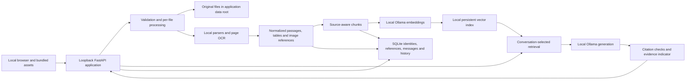

# Implementation Plan — Stage 1 Local Prototype

## Current execution point — R1-D static review complete

R1 closeout and partial repair are committed as `986305d` and `832bb06`. The user requested static launcher/accounting diagnosis. [Review findings](docs/benchmarks/public-source-static-diagnosis.md) leave the extra process unexplained and identify specific admission/accounting/completion defects. Recommended order is the separately proposed **R1-A fake-only accounting/verdict package**, then a separately approved instrumented launcher check if needed, then fresh public research. No helper/tests/workers/network/installation ran in this static review; old allocations remain closed. G2 remains open. Review-document commit and R1-A approval are separate. Earlier execution-point notes below are historical.

## Current execution point — design pack committed; R1startup stop preserved

Committed the approved11-file architecture/policy pack as `dbd9137`. The user approved R1; its new helper failed before any HTTP because the initialized ledger omitted `pending_bytes`, then the job-close adapter lacked `observe_native`. [Stop report](docs/benchmarks/public-source-review-stop.md):0requests/0bytes/0sources, closed allocation, original meter and readiness/source history preserved. Nine fake tests passed but missed this real initializer/close-protocol integration. No network-blocking or advisory finding is inferred.

Recommend the exact [R1-Sintegration repair](docs/provisioning.md#proposed-r1-s--startup-and-cleanup-integration-repair), zero network/candidate execution, before a separately approved fresh public review. Current helper/command must not rerun or be silently resealed. G2 remains open. Eleven source/stop-report/status files await separate commit approval; no repair or new allocation approved. Earlier proposed/ready-public-review wording below is historical.

## Earlier execution point — static T17pack

The user authorized T17-A1–A6 after readiness commit `e9d107e`. Concrete [architecture ADR](docs/ADR/0001-stage1-architecture.md), [C01–C08 contracts](docs/contracts.md), [dependency inventory](docs/dependencies.md#t17-a1--static-reconciliation-and-proposed-runtime-set) and [provisioning handoff](docs/provisioning.md#t17-static-pack--provisioning-and-validation-handoff) are prepared. All52installed metadata name/version pairs match the53-record lock; exact cached/report identities and historical limitations retained. User explicitly approved the quota classification,10GB conversation-only-original cap, resource/latency validation targets and minimal content-free deleted-target records; SPEC/decisions updated.

T17-A is complete as static design/review, not G2. Current advisory/native-notice freshness, trustworthy model-input fit, target-resource feasibility/representative parser/OCR/scale and exact native trust acceptance remain adoption gaps. The ADR is Proposed and T17/T18 remain gated. Recommend the separately bounded [R1public-source review](docs/provisioning.md#proposed-follow-up-r1--public-source-refresh-and-input-fit-method-review), then a concrete native-fit validation package only if warranted. No outbound/native/API/server/install/source/fixture/lock/environment change occurred. Eleven design/status files await separate commit approval. Earlier readiness-pending wording below is historical.

## Earlier execution point — T17 readiness proposal

T16 review updates committed as `cdbb975`. The user explicitly deferred the chart/diagram trial until after the first usable CSV flow/T34; the pre-G2 timing gate is satisfied by that deferral, while the evaluation/adoption requirement remains tracked. No other format, OCR, privacy, target-machine or acceptance requirement changes.

[T17 architecture readiness](docs/proposals/t17-architecture-readiness.md) provides the existing candidate inventory, concrete architecture direction, settled decisions and A01–A08 remaining readiness gaps. The proposed T17-A1–A6 static package will turn these into an actual proposed ADR/contracts/dependency inventory for G2 review; it does not authorize product code, installation, native/model/parser execution or new research/trials. Exact package and nine readiness/status-document commit approvals are requested separately. T16 is complete as static design; runtime adoption and detailed accounting/context/resource acceptance remain open. Earlier pending-chart/T16-commit wording below is historical.

## Earlier execution point — completed T16 review

Drafts committed as `486fd1b`; the user then approved R01 as a provisional validation baseline and R02/R08 indicator/recovery design. Together with the prior R03–R07 policy choices, this completes the T16-1–6 static package. [Review findings and clarifications](docs/retrieval-design.md#static-review-outcome-after-draft-commit486fd1b) separate ranked retrieval from supplied evidence, preserve error precedence and require durable deletion intent plus publication/reference coordination. No executable code, fixture/score changes, tests or runtime trials were introduced.

Next is T17 readiness review and its concrete approval package: exact architecture/components, token-fit/multi-file validation, detailed accounting/concurrency/recovery and resource/latency acceptance. T16A chart feasibility or explicit user-approved deferral remains a G2 prerequisite. Larger-scale/physical16GB acceptance and final component adoption are not inferred from T16 completion. Nine review-update documents await separate commit approval. Earlier pending-T16-review sections below are historical.

## Earlier execution point — T16 draft handoff

The user authorized the exact static package after proposal commit `cc08343`. T16-1–4 are drafted in [retrieval design](docs/retrieval-design.md) and [evaluation design](docs/evaluation.md#t16-draft--support-indicators-and-grounding-review): prerequisite gaps, source-aware chunks/scope/context, answers/citations, observable support states and claim-level evaluation. Existing fixture facts, IDs and scoring flags are unchanged; there are16active/9excluded questions and zero scoring-eligible questions. Definition JSON/hash and local document checks passed; no runtime test or new benchmark was run.

T16-5 review material and T16-6 checkpoint are ready. The user explicitly approved R03–R07 retention/display/counting directions and5GB processed/1GB temporary disk caps with a clear stop, synchronized into SPEC and the decision register. R01/R02/R08 context/indicator/recovery proposals and remaining T17 accounting/performance/adoption mechanics await review. Nine draft/status documents await separate commit approval. No G2, runtime adoption, upstream acceptance waiver or product implementation. Earlier package-pending wording below is historical.

## Earlier execution point — T16 proposal

T12-D results committed as `18be917`. The user approved the recommended direction: SQLite plus the exact reviewed sqlite-vec artifact is the preferred storage candidate, with final adoption at G2. [Decision register](docs/decisions.md) records the preference and measured trade-offs; D01/D04, target-scale/16GB/performance and architecture acceptance remain open.

Review the concrete [T16 static design package](docs/proposals/t16-grounding-contracts.md). T16-1–6 will map remaining prerequisites, draft retrieval/context/citation/support contracts, preserve the approved rubric and present explicit storage/retention choices. Drafting with a gap register is proposed; upstream final-acceptance prerequisites are not waived. No installation, native/model/parser execution, product implementation or new trial is included. Exact package and six proposal/status-document commit approvals are requested separately; the user's preference is already recorded and need not be approved again.

## Earlier execution point — completed T12-D review

Preparation committed as `e4db995`. The user completed runtime-03 with verified teardown and receipt persistence. [Native results](docs/benchmarks/sqlite-vec-match-results.md) confirm both controls, four B crash/reopen pairs and all four paired A/B measurements passed;192ranking/distance checks matched the independent reference. All37sealed identities and20prior records remain unchanged. The meter is closed at72/96reservations. D1–D6 are complete as this bounded evaluation; no retry or adoption is implied.

At1000vectors, pooled median search time was477.963ms for A and282.300ms for B, with larger B files and higher update costs. Review the trade-offs before selecting runtime storage, then agree the next T16 grounding package and T17/G2 prerequisites. Full T12 acceptance, product implementation, derived-storage/retention decisions, larger-scale capacity and physical16GB validation remain open. Results-documentation commit requires separate approval. Earlier readiness/proposal sections below are historical.

## Earlier execution point — T12-D readiness

D4 final freeze passed:1501.289conservative preparation seconds,56/96reservations,37seal/20prior identities verified, all five paid blocks closed/no native epoch. Proceed with already approved user-operated D5 via the handoff below; native correctness/adoption remain untested. Ten-file source/preparation commit approval is separate.

Approved package committed `5a82a70`. [Preparation](docs/benchmarks/sqlite-vec-match-preparation.md): exactMATCHred regression,29passing tests/Ruff,24original definitions preserved after name normalization,37sealed identities/20prior hashes/independentfixtures/launcher verified. An actual-source SQLite permission gate and14-day shadow fake schedule passed; native correctness remains untested. D1–D3 complete; D4 independent checks passed and final readiness is recorded in runtime-03/readiness.json before [user offline handoff](docs/proposals/sqlite-vec-match-handoff.md).56/96reservations and four fully prepaid blocks retain original limits; source/preparation commit separate. Next D5 user trial, D6 actual findings. Older pending-package statements are historical.

## Proposed next package — T12-D MATCH authorization correction

**Approved:** User explicitly approved both the exact package/execution boundary and five planning documents' commit. Runtime-03 meter initialized with12preparation reservations and300seconds prepaid before inspection/review/Git. Proceed D1–D6 sequentially within limits; later source/results commit remains separately gated. Earlier pending-approval wording is historical.

Native partial results committed `4146d7c`. Review [T12-D1–D6](docs/proposals/sqlite-vec-match-correction.md): exact single-function MATCH permission, test-first full SQL authorization/negative controls, fresh successor and independent readiness, then remaining B recovery and A/B32/1000measurements. Proposes96new starts with unchanged resource/native limits; prepaid external preparation blocks avoid uncertain idle-time accounting.14owned workers+2handoff reservations; prior four A recovery pairs carried forward without repetition. No allocation/code/tests/staging/installation/load has begun. Exact package/security boundary and five planning documents' commit await approval; old trials stay closed and adoption stays gated.

## Latest outcome — native MATCH permission refusal; trial closed

The user ran runtime-02 from960fa7c. [Partial native results](docs/benchmarks/sqlite-vec-runtime-followup-results.md) record both controls/four A recovery pairs completed, then B-before-commit reopened search blocked by the manifest's missing MATCH permission. Teardown and receipt persistence verified;70/96reservations, no paired performance measurements, all30sealed identities/13prior records unchanged. C5 partial stop/cleanup and C6 findings recorded; no adoption or implicit continuation. Withdrawn handoff stays closed. Next review a focused allowlist/query-contract successor proposal before code changes or a new native allocation; results-documentation commit remains separately gated. Earlier ready/pending-user-run wording is historical.

## Current execution point — C4 ready; C5 user offline trial next

User explicitly approved the one-time accounting recovery and ten-file commit. Original meter preserved; final readiness records1372.729conservative preparation seconds including180for documentation/Git,56/96reservations,30sealed identities/13prior records unchanged, no open segment/native epoch. No source edits/reseal or test repetition. C1–C4 complete; next follow the [approved offline handoff](docs/proposals/sqlite-vec-runtime-followup-handoff.md), then C6 actual findings. [Preparation report](docs/benchmarks/sqlite-vec-runtime-startup-correction.md) retains21-test/static evidence and accounting limitations. Earlier blocked statuses are historical; runtime-01 stays withdrawn and no adoption is inferred.

## Resume boundary — interrupted preparation accounting

On2026-11-16,30sealed identities/13prior records still match and21tests/static review remain valid. C4 final freeze was interrupted with an open active segment; the approved design requires refusal of uncertain continuation. [Concrete one-time accounting recovery](docs/proposals/sqlite-vec-runtime-startup-correction.md) proposes842provisional earlier seconds plus separately recorded resumed/finalization work under unchanged1800seconds/96starts. No settlement, readiness, timer reset, new allocation or native run has occurred. Review that narrow exception before C4; retain C5/C6/package/adoption gates. The handoff is withheld; earlier final-freeze-next wording is historical.

## Current execution point — T12-C correction and static review complete

Approved package committed `aef0b25`. [Correction evidence](docs/benchmarks/sqlite-vec-runtime-startup-correction.md): two initial regressions reproduced both defects;21tests/Ruff passed; original worker/search/workload contracts preserved;30sealed identities/13prior records and independently regenerated fixtures checked. A14-day delayed handoff completed the full fake schedule without changing actual state. C1–C3 complete; C4 independent review passed but final readiness freeze was not completed. Resolve the interrupted accounting decision before completing C4 or issuing the [user-run offline handoff](docs/proposals/sqlite-vec-runtime-followup-handoff.md); C5/C6 remain pending. No native evidence/adoption yet. Runtime-01 remains untouched and withdrawn; source/preparation-results commit is separately gated. Earlier proposal/resume statements are historical.

## Proposed next package — T12-C startup correction

**Approval recorded:** User said "please proceed" to the exact package/execution boundary and five-document commit. Fresh runtime-02 meter reserves8preparation starts for initialization/design/review/Git; proceed sequentially C1–C6 within limits. Later implementation/results commit remains separately gated. Earlier pending-approval wording is historical.

Failure closeout committed `8353db0`. Review [T12-C1–C6](docs/proposals/sqlite-vec-runtime-startup-correction.md): active preparation versus handoff waiting, startup terminal reporting, test-first successor harness and a fresh sealed32/1000comparison. Proposes a new96-start allocation with the existing time/resource/artifact/SQL boundaries and explicit prior/failed-launch accounting. Runtime-01 remains untouched; no replacement implementation or allocation exists. Package/execution-boundary and five-document commit approvals pending. Sequence: design/accounting review → failing regressions → minimal correction → independent readiness → user disconnected run/cleanup → factual results. No product adoption or stage transition.

## Latest outcome — T12 runtime startup stop

Preparation committed `d5e8c68`; runtime-01 stopped before any worker/extension load because the preparation timer counted human handoff waiting. [Failure evidence and proposed correction](docs/benchmarks/sqlite-vec-runtime-startup-stop.md) supersede the launch invitation below. Preserve the stale ready meter and all sealed files; no retry/reset/reseal. Review a fresh bounded timing/startup-reporting correction package before implementation or another native trial. T12/G2 remain open; earlier preparation statements are historical.

## Current execution point — T12 B1–B3 statically complete

[Preparation](docs/benchmarks/sqlite-vec-runtime-preparation.md) records10passing fake tests/Ruff, verified DLL-only staging with notices,24sealed identities/seven unchanged prior records,56/96reservations and724.167active seconds. No native loading or benchmark ran while connected. B4 is the already approved user-operated [disconnected trial](docs/proposals/sqlite-vec-runtime-handoff.md); maintain all recorded limits and preserve partial stops. Preparation source/results commit approval pending; T12/G2 remain open.

## Current proposal — T12 disconnected runtime comparison

**Approval recorded:** The user approved the exact96-start package, DLL-only staging and manual disconnected execution without filesystem confinement, plus these five planning documents' commit. Resume T12-B1 from [the saved checkpoint](docs/session-checkpoint.md), then proceed sequentially through the covered preparation tasks without repeated task-start approvals. No implementation or staging has begun. Carry forward the checkpoint's conservative bookkeeping reservations within the shared limits.

Companion-notice acceptance committed `48cdf72`. The [PartB proposal](docs/proposals/sqlite-vec-runtime-comparison.md) requests96shared starts,30active preparation minutes and one45-minute user-operated disconnected epoch, with cached DLL/notices staged inside project `.venv`, no Python-package install/download. Compare fresh A/B32/1000-row synthetic fixtures, scoped/tied reference rankings, both adapters' actual crash/reopen controls and resource/footprint timing. The old10k timeout remains closed. Explicit no-filesystem-confinement acceptance and exact package/five-document commit approval pending. No new source, cache staging, allocation or load occurred.

## Latest decision — exact-wheel companion notices accepted

The user accepted the [narrow companion-notice exception](docs/decisions.md) after artifact-review commit `3092aeb`. Preserve the exact wheel and both pinned upstream texts unchanged; retain all binary/runtime limitations. Next prepare a concrete project-local empirical comparison proposal for separate approval, including installation/loading boundary, frozen data/reference checks and fresh budgets. No empirical execution or G2 adoption is authorized by notice acceptance. Earlier pending-notice statements below are historical.

## Latest outcome — sqlite-vec artifact-only review

Approved proposal committed `dcb70be`. [Static review](docs/benchmarks/sqlite-vec-artifact-review.md) completed with11passing inspector tests, exact wheel/RECORD/AMD64/source identities and metered10HTTPattempts/641244body bytes. Missing bundled notices block progression pending a narrow companion-notice decision; static findings do not approve runtime loading or establish binary/source reproducibility. No dependency/environment or baseline changes. Next review that decision before any separate empirical package. T12/G2 remain open; source/results commit approval pending.

## Current proposal — exact sqlite-vec artifact review

T12 partial source/results committed `a54b38b`. The [artifact-only package](docs/proposals/sqlite-vec-artifact-review.md) proposes32shared starts/20active minutes,20HTTP attempts/8MiB response bodies with local metering, the exact292804-byte Windowswheel/SHA, bounded ZIP/RECORD/loader/license/PE inspection and synthetic negative controls. No installation, extension import/loading, model/OCR execution or baseline rerun. T12-V1–V5 and five planning documents' commit await approval; no artifacts/code/allocation created. Static review cannot establish runtime safety or comparison performance.

## Latest T12 outcome — partial baseline, no adoption

Approved proposal committed `976455c`. [PartA evidence](docs/benchmarks/storage-index.md):11focused tests, mutation detection, four actual crash/reopen cases,32/1000-row measurements;10000-row worker timed out at120seconds with verified cleanup. The single allocation is closed without retry. Optional candidate review identified exact registry wheel identity but did not establish binary/source provenance, runtime safety or browser transport-byte accounting. T12 remains incomplete; next review an exact-wheel artifact-only package with local byte metering. No extension installation or G2 adoption authorized.

## Current proposal — T12 local storage evaluation

Shortlist approved/committed `48f0333`. The [T12 proposal](docs/proposals/storage-index-evaluation.md) compares a standard-library SQLite/vector baseline with an optional sqlite-vec0.1.9 candidate. Proposed PartA:64shared starts/45active minutes, synthetic32/1000/10000-row768-dimensional vectors, scoped ranking/ownership/versioning, actual process-crash/reopen tests and resource/disk measurements; optional dependency review without installation/execution. PartB needs exact artifact review and separate approval. Product retention/derived-storage/latency decisions stay open; synthetic operations do not settle them. Package and five-document commit approval pending. No code, fixture, database or trial allocation created.

## Current recommendation — model/OCR shortlist

**Approval recorded:** The user accepted the three preferred candidates and approved the five-document commit with "yes commit". T11-SEL is complete; T12-P remains next. Earlier pending-shortlist wording below is superseded by this decision, without changing the T17/G2 adoption gate.

Combined-07 user acceptance is committed in `69a01b4`. The [model/OCR recommendation](docs/proposals/model-ocr-selection.md) proposes Qwen2.5 1.5B Q4_K_M, Nomic v1.5 and Tesserocr2.13.0 with the evaluated pinned English/native assets as preferred candidates. Shortlist approval is pending and does not replace T17/G2 adoption. Next core sequence is T12 storage evaluation → T16 grounding contracts → T17 architecture/adoption, retaining OCR/parser/chart/retention and physical16-GB gates. No new code, execution or provisioning is authorized by this recommendation.

## Latest outcome — combined-07 completed

[Native results](docs/benchmarks/combined-ocr-model-seventh-results.md) confirm all36answers, four controls and24positive OCR/chat overlaps, with verified owned teardown. Results committed in `b225d57`; the user subsequently confirmed all36answers/citations are good. T11-C7-1–6 are complete, including qualitative local review. Next prepare the model/OCR adoption decision for separate review; no adoption, new package, native rerun or stage transition is authorized by this acceptance. Physical16-GB validation and other unresolved acceptance gates remain open. Acceptance-note commit approval is separate.

## Current approved package — combined-07 (2026-11-14)

The [combined-07 package](docs/proposals/combined-ocr-model-seventh-run.md) and proposal commit `1dddbcb` are approved. T11-C7-1–3 static preparation is complete: expected red routing errors,61green combined/OCR tests, Ruff checks,158sealed identities,18unchanged prior records,44/160reservations, zero API/native attempts and offline epoch unset. [Evidence](docs/benchmarks/combined-ocr-model-seventh-preparation.md) and the [standalone handoff](docs/proposals/combined-ocr-model-handoff.md) are ready for T11-C7-4's user-operated disconnected run. Preparation source/results commit approval remains separate; S01–S15 semantic review remains pending. Older snapshots below are historical.

## Current package — 300-ms monitor policy (2026-11-14)

Combined-06 preparation/partial results are committed in `eeda648`; all native allocations remain closed. The user approved the [300-ms policy package](docs/proposals/combined-monitor-300ms.md) and proposal commit `7586f68`. T11-T300-1–4 implementation/verification is recorded in the [results](docs/benchmarks/combined-monitor-300ms.md):61passing fake contracts, focused lint/format, one ceiling shared by both guards; memory limits and100-ms cadence unchanged. Shared32-start/ten-minute boundary applies through final closeout. Implementation/results commit and a new native package remain separate gates. S01–S15 local semantic review remains pending. Earlier package snapshots below are historical.

**Current bounded package (2026-11-14):** OCR manual-04 completed and results committed in 94f3e46; the user approved T11 combined feasibility implementation, offline testing and scoped reviewed commit. Combined-01 stopped on a deadline schema mismatch with verified teardown. Combined-02 also stopped at its first sentinel with FileNotFoundError and verified teardown. The approved [fake-only storage diagnostic](docs/benchmarks/combined-storage-diagnostic.md) is complete; the approved [live storage repair](docs/benchmarks/combined-storage-repair.md) passed24 fake contracts and its scoped commit is authorized. The user approved [combined-03](docs/proposals/combined-ocr-model-third-run.md) with unchanged models/schedule/limits and a new160-start allocation; native execution remains the disconnected user-operated phase. T09 quality/rotation/provenance and remaining T11/G2 adoption gates stay open. Earlier progress snapshots below are historical.

## Latest approved scope - PDF/XLSX/CSV

The user deferred legacy XLS on 2026-11-13. T07A and T37 are excluded from Stage 1, with their earlier evidence retained. T08 now depends on T05/T07; T16/T17 and acceptance no longer depend on XLS evaluation or implementation. T38 follows T36, bypassing T37. T08 closes with user-approved non-adoption and empirical-trial deferral; the T09 read-only OCR review is authorized. OCR execution/install/adoption remain gated. Earlier format-amendment and T02R paragraphs below describe historical decisions superseded by this amendment.

**Status:** Approved; T01–T03 and T05 complete, T04 explicitly deferred by the user. T05 closes with approved PyMuPDF empirical-comparison deferral. T02R definition refresh is complete; user approved the reviewed definitions and commit. Format scope is PDF/XLSX/CSV; remaining downstream revisions, provisioning/adoption/implementation retain their gates.

**Prepared:** 2026-11-13 (Asia/Calcutta).

**Requirements:** User-approved `SPEC.md`; process governed by `AGENTS.md`.

**Task tracker:** Root-level `TODO.md`. Baseline setup verified; optional SkillSpector deferred in `docs/benchmarks/skillspector.md`. No application implementation or model trial has started; T05 PDF evaluation is complete. Decisions: `docs/decisions.md`; design: `docs/evaluation.md`; setup: `docs/provisioning.md`.

## Format amendment and proposed task revision — 2026-11-13

Historical first amendment: the user approved PDF, XLS, XLSX and CSV, replacing DOCX/TXT. The latest amendment above defers XLS. T05 is committed in d8d12e7. Propose T02R to update active fixtures/questions while retaining historical definitions; exclude T06, add T07A for legacy XLS evaluation, and change the first vertical slice from TXT to CSV. Repurpose the unstarted T37 slot for XLS implementation and T39 for CSV robustness after its initial T23–T34 slice. Task IDs for completed work are unchanged. Review these sequence changes before further trials; no dependency/model provisioning is authorized.

T08 depends on T05 and T07 (T06 and T07A excluded). T17 must resolve all three required formats and their license/security/provenance questions. DOCX/TXT definitions are historical only: no Stage 1 parser work, dependency evaluation/install, fixture generation, benchmarking or positive-support acceptance. Later support requires explicit user approval. No further XLS fixture or sample work is planned in Stage 1.

**T02R evidence:** The user authorized the definition refresh after e1ee6ff and reconfirmed XLS is required. `docs/evaluation.md` now records S-XLS/Q21–Q25, S-CSV-INJECTION/Q20, 21 in-scope questions, four historical exclusions and explicit scoring-readiness gates. Definitions/source integrity checks passed; no documents generated or new packages installed. Those historical XLS gates are now deferred outside Stage 1. T02R closeout/commit approved; T07 review is now authorized and in progress. Original T02 counts below are historical, superseded by this refresh.

**T07 current work:** User approved the exact package and three process improvements. Bounded results were reviewed and approved for commit in `docs/benchmarks/tabular-text-parsers.md`: 40 original-file runs, sampled agreement and controls, with encrypted/VBA/full-scale gaps and the combined worker-budget overrun. No runtime adoption/application ingestion. T07/process changes are committed in e8ec471. T10 provisioning and the separately approved continuation comparison are complete; see docs/benchmarks/embeddings.md for results and original accounting limitations. T10 is committed in 55d68f6. The approved T11A no-download continuation completed all 96 planned request slots across epochs, retaining the original timeout; measurements and the pending local semantic-review gate are in docs/benchmarks/chat-models.md. No automatic model adoption or next-task execution; T07A XLS is now deferred outside Stage 1.

## Approved process refinement and execution priority — 2026-11-13

The user approved all three improvements while authorizing the complete T07 package: consolidate settled SPEC decisions, bundle exact bounded-task permissions, and prioritize model feasibility plus the CSV-first slice. The T07 approval covers its three pins, fixtures, tests, measurements and specified budgets without another task-start question. Git commit, G2 adoption, scope changes and work exceeding approved artifacts/budgets still need explicit approval.

Revised execution order after T07: **T10 → T11A → T08 → T09 → T11 → T12 → T16 → T17/G2 → T18–T34**, with T15 before T33. T11A uses fixed verified evidence to expose CPU-only chat limitations early; T11 later combines those settings with OCR/embedding contention after T09. No model provisioning is authorized by moving the task. T08 MarkItDown remains required before parser adoption; T07A XLS is deferred. T16A chart evaluation or an explicit runtime-scope decision remains required at G2.

T13/T14 optional developer-tool reviews move after the first CSV slice (or immediately before proposed tool use); they cannot block core architecture or a working answer path. T15 UI UX Pro Max stays a separate evaluation before frontend implementation, with manual design as a reviewed alternative. No tool is implicitly adopted, installed or declared evaluated. Core G2 approves the already selected minimal HTML/CSS/JavaScript approach; later design-aid evaluation cannot silently change that stack.

This order prioritizes CSV upload → retrieval → local answer → citation → saved conversation. XLSX, native/scanned PDFs, lifecycle, privacy and full acceptance remain required later slices; a first CSV demo does not satisfy all Stage 1 criteria. Complete-model resource adoption still needs combined evidence, not early fixed-evidence timings alone.

## 1. Planning basis and current state

The user approved SPEC and the persistent project rules, then explicitly requested this planning step. Earlier deleted plans are not approvals or execution evidence. These documents are a new proposal derived from the current SPEC and rules; SPEC is not changed.

The workspace contains project documents, local skills/reference material, two UI reference images, and an initialized Git repository. At inspection all project files are untracked, no files are staged, and no application source, project environment, dependency manifest, lockfile, test suite, benchmark report, or selected parser/OCR/model/index exists. Representative office-document fixtures still need to be agreed. Workflow/reference docs do not establish application capabilities.

The local `skills/planning-and-task-breakdown/SKILL.md` was read and applied. The project's root-level PLAN/TODO convention overrides the skill's default `tasks/` paths. No alternate tracker or speculative source tree is created. Other skills are read when their work is authorized and relevant, not preloaded.

This delivery creates PLAN/TODO and synchronizes only the current planning state in AGENTS/README. It does not install dependencies, retrieve models/tools, run product experiments, initialize additional repositories, stage files, or commit.

## 2. Scope

Stage 1 delivers one browser-based local application for one user on **Windows 11, 16 GB RAM, no dedicated GPU**:

- Validated single/batch PDF, XLSX and CSV uploads with per-file progress, warnings, success and useful errors.
- Native-text and scanned/mixed PDF extraction through local OCR; useful document structure, tables, image/page references, extraction method/version and warnings retained.
- Conversation-specific attachments plus a reusable library with shared bytes and explicit reference/lifecycle rules.
- Local extraction, chunking, embeddings, vector storage, scoped retrieval and Ollama answers with real citations, passage previews, and understandable evidence-support signals.
- Locally saved messages/conversations: list, reopen, rename, delete, and restore document context after restart.
- Reproducible tests/evaluation, CPU/memory benchmarks, dependency/license inventory, setup/user instructions, ADRs, architecture diagram and an acceptance demo.

Exclude Stage 2/3 functionality: multi-user auth/RBAC/OAuth, company-server deployment, MCP/business actions, desktop packaging, graph-assisted retrieval, hosted models/embeddings, and additional document formats. `graphify` has no Stage 1 trial or runtime task. Advanced chart/diagram reasoning remains an explicit decision; it is not implied by extracting images or OCR text.

Keep application runtime, content, prompts, embeddings, answers, assets, storage and logs local after approved provisioning. Stage 1 includes verification that core runtime does not need external network traffic. The later strict disconnected-runtime deployment gate does not permit cloud processing or telemetry now.

## 3. Decision register

Status is recorded below and in `docs/decisions.md`. T01 records explicit answers or user-approved deferrals and the dependent tasks that remain blocked. Changes to approved requirements need a reviewed SPEC amendment before dependent implementation.

| ID | User decision | Blocks |
|---|---|---|
| D01 | Approved: 100 MB per file, 10 files per upload/conversation, 1 GB of library originals; derived-data budgets/enforcement details still need review | Trial sizes, resource budgets, validation and scale tests |
| D02 | Approved: English-only OCR | OCR trial/assets and parser adoption |
| D03 | Bounded chart/diagram evaluation scope approved; see SPEC clarification and `docs/proposals/chart-interpretation.md`; T16A proposes the investigation | Exact trial provisioning/execution and runtime adoption remain gated |
| D04 | Approved: delete chat-exclusive attachments, preserve library/shared content, and warn/block library deletion while referenced by saved chats. Remaining message/citation/detached-reference/derived-artifact retention needs agreement before implementation | Ownership schema, deletion contracts and lifecycle implementation; SQLite/document IDs are already Stage 1 |
| D05 | Approved: minimal local HTML/CSS/JS; Design 1 landing, Design 2 chat/citations/evidence | A framework requires separate review |
| D06 | Approved timing: final speed/memory targets after initial benchmarks, before T17 adoption; bounded trial budgets first. Quality rubric/thresholds remain for T02/T16 | Initial measurements exploratory; adoption/acceptance requires agreed targets |
| D07 | Representative non-sensitive samples, permission to use them locally, and safe versioned evaluation material | Fixture/rubric design and reproducible experiments |
| D08 | Exact RTK and ponytail projects and intended benefits | Separate optional trials; ambiguity may be explicitly deferred |
| D09 | Exact trial downloads/installations, versions, disk budget, model/language assets and setup internet access | Before the exact bounded trial package; one approval covers its named provisioning/fixture/execution steps, not unlisted artifacts |

Already confirmed: both library and chat attachments are required; library references share stored bytes; deleting a chat must not silently delete library documents; library removal warns about dependent conversations and defines historical citation behavior. Do not reopen these as optional scope or promise forensic secure erasure.

## 4. Authorization and workflow

| Gate | Concrete material to review | Required decision |
|---|---|---|
| G0 — Plan review | PLAN/TODO, open decisions and task order | Approve/revise plan and identify the next authorized task, normally T01 |
| G1 — Each trial | Exact project/artifact/version, license/security review, download/install commands, fixture/method and resource budget | Authorize that bounded provisioning/trial before it runs |
| G2 — Design/adoption | T17 architecture pack with T05–T16 evidence, selected components, contracts and lifecycle policy | Approve exact design/model/dependency choices before product implementation |
| G3 — Coherent package closeout | Actual checks/results, review, affected docs/status and readable diff | Review completion and explicitly approve commits; continue already approved tasks without redundant start permissions |
| G4 — Acceptance | T50 demo and acceptance matrix with all evidence | Stage 1 sign-off; Stage 2 requires a separate explicit transition decision |

Existing permissions persist for their approved scope; do not ask twice for the same action. A plan, draft ADR, passing test or standing rule is not permission to install a tool, choose a retention policy, commit, or begin an unapproved task.

Work sequentially through tasks named in an approved bounded package. Reordering outside that package or changing its budgets/artifacts needs review; no parallel agents are authorized. Schema, shared contracts, API/UI integration and destructive lifecycle work remain sequential.

For each approved task/package, inspect state and criteria, verify relevant skills, perform bounded work and checks, review, update TODO, and update README for the coherent result. Change PLAN for actual sequence/scope changes and decision records for consequential choices; avoid duplicating every transient status across all files. Implementation uses incremental implementation and TDD; API/frontend skills when warranted; code review at completion; security review for uploads/parsing/trust boundaries; documentation/ADR guidance for consequential decisions. Never weaken tests to pass.

Each task targets one focused session and normally at most five substantive files; routine PLAN/TODO/README updates are additional. Split a task before execution if it proves larger. Spikes may use approved isolated local evaluation aids without adopting them into product runtime. Documentation-only tasks use consistency/link/diff checks, not fabricated application tests.

TODO includes checkpoints after every 2–3 tasks. Each checks accumulated evidence and provides a human review boundary in addition to G3. Verify `/status` support at appropriate boundaries; use `/compact` only when needed after persisting decisions/task/test state. Do not claim either command ran if unavailable.

## 5. Architecture proposed for evaluation and approval

Baseline direction from SPEC: Python 3.11+, FastAPI/Uvicorn, HTTPX for loopback Ollama, SQLite metadata/history, and a small local browser frontend. Use `uv`, a project-local `.venv`, `pyproject.toml` and `uv.lock` when approved dependencies are introduced. Versions, models, OCR engine, parsers, vector representation, UI tooling and processing strategy are not selected by this diagram.



Boundary contracts to approve in T16/T17:

- **Content and provenance:** keep originals separate from normalized outputs. Carry stable document/extraction/chunk identity, content hash, display filename/format, parser/version, native/OCR method, warnings/confidence where available, and source anchors through answers and previews. PDF pages/table regions/images; XLSX sheet/cell ranges; CSV record/column and physical-line spans. Unknown precision is explicit.
- **Ownership and persistence:** distinguish stored content from document ownership and conversation/library references. Hash-based deduplication must not merge conversation visibility. Persist processing state, messages, timestamps and selected references needed for restart; evolve schema with each slice rather than implement all future tables upfront.
- **Index and retrieval:** deterministic chunk metadata, explicit parser/extraction/embedding/index versions, idempotent indexing, scoped relevance search, bounded context/history and a defined rebuild/recovery strategy. Reindexing and removal must not leave stale searchable evidence.
- **Generation and citations:** separate system policy from untrusted documents/model output/history. Ground answers in selected evidence; abstain when insufficient and handle ambiguity explicitly. Validate returned citation IDs against supplied passages; derive location/filename from provenance rather than model guesses. Quote/location checks and valid IDs do not prove every claim is supported.
- **Evidence indicator:** specify observable citation validity/coverage, abstention, warnings and limitations. Define what is checked automatically versus evaluated manually. Do not imply calibrated accuracy or unvalidated semantic verification.
- **Processing/API/UI:** define upload limits, per-file states, partial failures, retry/restart handling, errors, timeouts, bounded work and preview routes. Support accessible progress/empty/error/chat/library/source states without exposing backend details unnecessarily.
- **Lifecycle/security:** approved deletion/reference semantics across SQLite, original/derived files, vectors and saved citations; explicit partial-failure reconciliation. Constrain files to the data root, preview via IDs and selected references, render untrusted content safely, and review loopback Host/origin handling without adding multi-user auth.

Create modules/directories only when a real task needs them. Preserve existing workflow/reference/image directories. Exclude environments, runtime/private data, secrets, model assets, generated document files and local databases before any staging. No application feature is claimed until its slice is verified.

## 6. Evaluation tasks and dependency review

All candidate names below come from SPEC/rules or describe an alternative to investigate. This plan does not assert a current version, maintenance status, license outcome, Windows support, installation success or benchmark performance; verify those during the authorized review using primary sources.

For each candidate/artifact, record exact upstream repository/version/digest where applicable, purpose, alternatives including standard-library/no-tool options, license and transitive/native obligations, maintenance/security findings, scripts/permissions/outbound calls, Windows/CPU support, footprint/resource use, offline assets/behavior, and adopt/reject/defer decision. Ask before optional installation and separately before adoption. Reports belong in `docs/benchmarks/`, major choices in `docs/ADR/`, inventory in `docs/dependencies.md`.

| Tasks / milestone | Trial | Evidence |
|---|---|---|
| T03 — before trials | Baseline Python/uv/FastAPI/Uvicorn/HTTPX/pytest/Ruff and transitive/native assets | Host/version inventory, validated command proposals, license/security/offline comparison and scoped provisioning proposals |
| T04 — before additional third-party skills | SkillSpector, exact identity to verify | Small benign/suspicious local skill fixture, scripts/permissions/external calls, false positives/missed risks; manual review, never a security guarantee |
| T05 | Native PDF alternatives, including PyMuPDF as a candidate | Text/page/table/image provenance, corrupt/protected input, resource costs and licenses |
| T06 | Excluded: DOCX | Retired task ID only; no Stage 1 development, trial or dependency |
| T07 | XLSX alternatives including openpyxl; standard-library CSV baseline | Sheets/cells/headers/formulas without execution, encodings/quoted cells, memory and record/line provenance |
| T07A (deferred) | Legacy XLS outside Stage 1 | Historical review/preflight retained; no further trial or adoption in this stage |
| T08 - closed with approved exception | MarkItDown v0.1.9 source/dependency review | User accepted non-adoption and empirical-trial deferral; no measured comparison or runtime adoption. See docs/benchmarks/markitdown.md |
| T09 | Local OCR alternatives, e.g. a Tesseract-based path and another viable Windows/CPU option | Approved languages, page detection/native-vs-OCR distinction, ground-truth accuracy, rendering/native assets, warnings, resource/offline results |
| T10/T11 | Ollama embedding/chat candidates | Actual-machine quality/latency/memory; `embeddinggemma` and `qwen2.5:3b` are candidates, not defaults |
| T12 | SQLite metadata plus local vector alternatives | Minimal representation versus justified index library; ranking/persistence/delete/rebuild/versioning and interrupted-write integrity |
| T13 and T14, separately | User-intended RTK and ponytail | Exact identity first; one representative developer-workflow trial, trust/license/Windows support and benefit; no assumptions from names |
| T15 — before UI implementation | UI UX Pro Max | Local non-sensitive design exercise, generated-code/asset review, licensing, accessibility, upload/chat/library/citation states; manual design fallback |
| Checkpoints | `/status`, `/compact` | Host availability and persisted state; neither is a runtime dependency |

Reading the explicitly requested local planning skill is authorized; it did not execute bundled scripts or install tools. T04 concerns later acceptance of additional third-party instructions. If an optional tool is unavailable, ambiguous or rejected, record the evidence and obtain agreement on deferral/manual fallback. Do not block required product functionality indefinitely or silently skip a mandated evaluation.

## 7. Reproducible benchmarks and tests

T02 defines an approved compact fixture manifest and rubric before trials. Cover all supported formats, native/scanned/mixed PDFs, tables/images, XLSX sheets/merged headers/stored formula values, and CSV quoted/multiline cells/encoding. T02R revises the original corpus before scoring. Include unsupported, malformed, protected, extension/content mismatch, resource-boundary and injection cases. Do not evaluate unapproved languages, file limits or semantic visual requirements by assuming defaults.

Version safe authored question/answer/location manifests and fixture definitions. Keep user documents and generated PDF/XLS/XLSX/binary artifacts ignored/local or temporary; do not commit them. Record fixture identity/hashes. No tool trial receives content over an external service; reports/logs must not expose sensitive content.

Actual-machine Ollama protocol in T10/T11:

1. Record CPU, physical/available RAM, OS/Ollama versions, background load/power mode, CPU-only operation, exact model artifact/license/quantization/settings/context and fixture hashes.
2. Agree a bounded candidate shortlist and provisioning budget. Compare approved CPU-suitable alternatives; do not download models from names alone or select by file size alone.
3. Fix prompts/evidence/questions/settings. Proposed trial sampling: one cold load and at least three warm repetitions per scenario, subject to user-approved budget. Retain failed runs/raw measurements and variation; small samples do not justify confident tail-latency claims.
4. Embeddings: input limits/truncation, dimensions, query/document consistency, batch throughput, retrieval relevance/recall at chosen k, index footprint and memory. Changed embedding models imply explicit index-version/rebuild decisions.
5. Chat: load/time-to-first-token where measurable, full response latency/token throughput, grounding, real citation support/correctness/coverage, abstention, ambiguity, multi-file/table answers and history contamination. Early trials can use fixed gold evidence before the product retriever exists.
6. Observe combined app/evaluation/Ollama/OCR working set, system RAM/pagefile pressure, indexing/query contention and embedding/chat load/unload behavior. Approve context/batch/concurrency limits based on measured headroom.
7. Verify only approved local endpoints/assets are required. Compare results with D06 budgets; if none meet requirements, present tradeoffs for a user decision instead of silently reducing scope or using cloud APIs.

Parser/OCR reports compare expected extraction structure/anchors, fidelity/accuracy, warnings, protected/error behavior, peak memory, time, native asset footprint and offline operation. T12 uses approved volume/embeddings and exercises insert/query/restart/remove/rebuild/interruption. T16 approves measurable relevance/grounding/citation/refusal thresholds before implementation.

Implementation verification: meaningful failing tests first, smallest change, refactor; typed/public documented interfaces, Ruff/PEP 8, focused tests plus relevant regression suite. Routine Ollama requests are mocked; actual model/OCR checks are separately labelled local integration/smoke tests. Anticipated commands after approved setup are `uv run pytest <focused-path>`, `uv run ruff check .`, `uv run ruff format --check .`; validate before documenting them as operational. A minimal static frontend need not have a build command; do not invent one or add tooling merely to satisfy a template.

## 8. Ordered milestones and dependency map

TODO holds the complete atomic criteria/files/evidence. T01 through T03 and T05 are complete; T04 is deferred; the user accepted deferring PyMuPDF's empirical comparison. T06 is excluded from Stage 1. T02R was explicitly authorized, verified and approved at closeout; T07 remaining coverage and downstream tasks retain their review/execution gates; T07A is deferred.

| Milestone | Tasks in default execution order | Review outcome |
|---|---|---|
| M0 — Decisions/evaluations/design | T01 decisions; T02 fixtures/rubric; T03 environment/dependencies; T04 SkillSpector; T05 PDF; T02R corpus revision; T06 excluded; T07 XLSX/CSV; T10 embeddings; T11A early chat; T07A XLS (deferred); T08 MarkItDown; T09 OCR; T11 combined chat; T12 storage; T16 grounding; T17 core architecture | G1 trial approvals throughout; G2 design/component adoption before app code |
| M1 — Minimal foundations | T18 reproducible project; T19 local startup/config; T20 ownership persistence; T21 provenance contracts; T22 fixture harness | Tested foundations only; no complete future schema or unused modules |
| M2 — First upload slice | T23 safe CSV attachment; T24 batch/status; T25 extraction/preview | User can upload and inspect traceable local text |
| M3 — First answer slice | T26 chunk; T27 embed; T28 index; T29 retrieve; T30 grounded chat; T31 citations; T32 indicator; T15 UI aid review; T33 browser flow; T34 saved chats | CSV upload → answer/abstention → citation → restart/reopen |
| M4 — Required format expansion | T35 native PDF; T36 scanned/mixed OCR; T37 XLS (deferred); T38 XLSX; T39 CSV robustness; T40 mixed-format integration | Three formats with table/image/OCR provenance and disclosed limitations |
| M5 — Library and lifecycle | T41 library upload/list; T42 references/scope; T43 impact warnings; T44 document removal; T45 chat deletion | Shared bytes, safe scope, approved removal/retention and citations |
| M6 — Acceptance | T46 security/recovery; T47 offline traffic; T48 quality/resource baseline; T49 setup/inventory/docs; T50 demo/sign-off | G4 evidence; no automatic Stage 2 transition |

```text
G0 → T01 → T02 → T03 → G1 approvals for trials
T02/T03 → T04 → T05; T02R → T07; T05/T07 → T08 → T09
T07 → T10 → T11A → T08/T09 → T11 → T12
T34 → T13/T14 (or before tool use); T17 → T15 → T33
Required parser/model/storage/grounding evidence → T16 → T17 → G2 (T13–T15 do not block core G2)
G2 → T18 → T19 → T20 → T21 → T22
T22 → T23 → T24 → T25 → T26 → T27 → T28 → T29
T29 → T30 → T31 → T32 → T33 → T34
T34 → T35 → T36 → T38 → T39 → T40
T40 → T41 → T42 → T43 → T44 → T45
T45 → T46 → T47 → T48 → T49 → T50 → G4
```

Arrows indicate prerequisite direction; slashes indicate separate prerequisites/independent investigations, not permission to parallelize. TODO's detailed prerequisites govern. Optional-tool conclusions can be user-approved deferrals; essential provenance/model/OCR/storage decisions cannot be silently deferred past G2.

The CSV path proves the full pipeline before every parser is built. Each later format extends that tested path and receives end-to-end citation verification. Minimal ownership distinctions are established before uploads; reusable-library operations and approved removal behavior arrive as later slices. Rename/reopen is separate from deletion so retention is never guessed during chat persistence work.

## 9. Acceptance traceability

| Requirement/criterion | Tasks | Required evidence |
|---|---|---|
| FR-01 single/batch upload, validation/status | T23–T24, T35–T41 | Valid/bad/protected/oversized/traversal/mismatch tests, mixed-success status and useful UI errors |
| FR-02 extraction/provenance | T21, T25, T35–T40 | Golden page/sheet/cell/paragraph/line anchors; table/image references; parser/version/native/OCR flags/warnings |
| FR-03 chunk/embed/index/dedup/remove | T26–T29, T44 | Stable metadata, version/restart/retry/idempotency, correct scope and removed content excluded |
| FR-04 grounded conversational answers | T29–T30, T33–T34, T48 | Supported/unsupported/ambiguous/multi-file/table/history-injection examples and quality rubric |
| FR-05 real citations and passage previews | T25, T31, T35–T40, T43–T44 | IDs tied to supplied evidence, no invented locations/quotes, honest coarse anchors and missing-source handling |
| FR-06 saved chats and context | T20, T30, T34, T41–T45 | List/reopen/rename/delete, actual restart, correct references and library survival |
| FR-07 evaluation and support signal | T02, T16, T32, T48 | Repeatable questions/rubric/results, meaningful support explanations without accuracy probability |
| Both document organizations | T23, T41–T45 | Reused library bytes, distinct ownership, no cross-chat scope leakage, dependent-citation warnings |
| Practical CPU-only 16 GB use | T09–T12, T48 | Combined memory/pressure/latency at approved workload and limits |
| Local/private runtime | T19, T46–T47 | Loopback/local assets, no remote fallback/telemetry/downloads, redacted logs and observed offline core workflow |
| Reproducible deliverables | Every task, T49–T50 | Tests/Ruff, README/setup/lockfile/license inventory, diagram/ADRs, reports, demo and user sign-off |

## 10. Risks and mitigation

| Risk | Consequence | Mitigation/gate |
|---|---|---|
| CPU/RAM/latency insufficient for simultaneous workloads | Unusable prototype or paging | Early actual-machine trials, approved context/batch/concurrency/volume budgets; return infeasible choices to user |
| Tables/OCR lose source precision | Unsupported answers or misleading citations | Golden anchors/structure before parser adoption, region/page fallback and warnings |
| Windows/native tooling or licenses unsuitable | Installation failure or incompatible dependency choice | Exact artifact/license/transitive/native review and alternatives before provisioning/adoption |
| Small model invents claims/citations | Misleading grounded-answer presentation | Scoped evidence, citation checks, abstention, adversarial/manual evaluation and explicit remaining limits |
| Deduplication conflates ownership | Cross-chat leakage or loss of shared content | Separate content/reference identity, scope tests and approved lifecycle policy |
| Crash leaves files/SQLite/index inconsistent | Orphans/stale evidence or incomplete removal | Explicit states, idempotent retries, versioning/reconciliation, failure-injection/restart tests |
| Optional skill/tool runs unsafe code or sends data out | Privacy/trust violation | Exact identity, manual instruction/script review, scoped approval and local fixtures; reject remote processing paths |
| Missing samples or undecided requirements | Unverifiable acceptance or scope drift | T01/T02 blockers and explicit deferrals; never invent data/thresholds/approvals |

## 11. Review and stopping point

Review actual bounded-package evidence and gaps. Next proposed package is **T10 read-only service/model/embedding review**, followed by T11A fixed-evidence chat feasibility. Exact model/service assets and trial budgets need approval before provisioning. No application scaffolding or runtime adoption is authorized merely by this plan.

**Current progress:** T01–T03/T02R/T05 complete, T04 deferred, T06 excluded. The user approved committing T07 bounded trial results and the three process improvements; remaining T07 acceptance coverage is still open. The report records encrypted/VBA/full-scale gaps and regression workers omitted from the trial counter. No application/model benchmark or runtime adoption occurred. Target stays 16 GB/CPU-only; T18 is not otherwise complete. TODO is the detailed status authority.

## Approved T11 combined-04 continuation — 2026-11-14

The resource diagnostic repair and combined-03 stop reports are committed in `28844cb`. The user approved the [combined-04 package](docs/proposals/combined-ocr-model-fourth-run.md) and committing its five proposal documents: same evaluation and limits, fresh linked allocation and repaired reporting. Ordered tasks T11-C4-1 through T11-C4-6 are in TODO. Bounded preparation and the disconnected user-run trial may proceed; later source/results commits remain gated. Earlier execution/status statements above are historical where superseded by current TODO and checkpoint evidence.

## Approved monitoring repair after combined-04 stop

Combined-04 results are committed in `74fb75a`; its matrix stopped before scored answers and its allocation is closed. The user approved the [bounded monitor repair](docs/proposals/combined-monitor-cadence-repair.md): preserve the 250-ms hard ceiling, account for check work in the 100-ms cadence, and measure actual reading/scan intervals. T11-M1–M4 in TODO may proceed within a fresh 32-start/ten-minute fake-only allocation. The five proposal documents' commit is approved; later source/results commits remain gated. No native continuation or timing-limit relaxation is authorized.

## Approved combined-05 continuation

The monitor repair is committed in `0b345d5` after 34 passing fake tests. The user approved the [combined-05 package](docs/proposals/combined-ocr-model-fifth-run.md) and committing its five proposal documents: repeat the fixed matrix with that repair and all existing ceilings, using a fresh linked allocation. Ordered tasks T11-C5-1–C5-6 may proceed within the bounded package; native execution remains the disconnected user-run step. No download or later source/results commit is approved. The earlier repair allocation is closed.

## Approved state-file investigation after combined-05 stop

Combined-05 preparation/results are committed in `888f184`/`dbe607a`; its allocation is closed. The user approved the [diagnostic package](docs/proposals/combined-state-write-investigation.md) and its five proposal documents' commit. T11-SW1–SW4 may proceed within32starts/ten-active-minutes using synthetic JSON and one fixture-only Windows sharing-handle case. Source leads remain unproven historical causes. No writer-policy repair, permission change, timing relaxation or new native trial is authorized; later source/results commits remain gated.

## Approved state coordination repair

Investigation source/results committed `612378a`. User approved the [minimal repair package](docs/proposals/combined-state-coordination-repair.md) and its five proposal documents' commit: share the existing lock across core writers/combined OCR reads, suppress only unchanged descendant state writes and preserve atomic failure/accounting/timing behavior. T11-SR1–SR4 may proceed within40starts/15active minutes, up to five existing source/test files and both fake suites. Later repair source/results commits and any native continuation remain gated.

## Approved combined-06 continuation

State coordination repair is committed `92f3b67` after60passing combined/OCR tests. The user approved the [combined-06 package](docs/proposals/combined-ocr-model-sixth-run.md) and committing its five proposal documents: fixed experiment, both repairs, unchanged limits and a fresh allocation linking15prior records. T11-C6-1–C6-6 may proceed within the package. Both fake suites precede handoff; standalone OCR tests join the seal inventory. Native execution remains the disconnected user-run step; later source/results commits remain gated.
