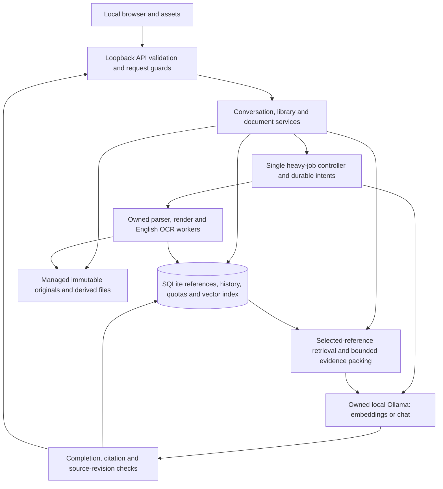

# ADR0001 — local modular document assistant

## Status

**SV2 follow-up, 2026-11-19:** [Exact dependency findings](../benchmarks/t17-standalone-validation-closeout.md) verify the full seventeen-node graph, ten current registry/wheel identities and three exact publication subjects. These do not supply the remaining build-source/native-notice evidence. Installation and standalone/selected-Ollama parity remain blocked; B01–B03 and the Proposed G2 status are unchanged. No new architecture or runtime adoption follows from the user's work/commit authorization.

**User-selected counting direction, 2026-11-19:** standalone Hugging Face tokenization with pinned local assets is now the chosen route for input accounting; Ollama continues generation/embeddings. Retain the existing 0.23.3 candidate/full dependency graph for focused validation. [Decision](../decisions.md#2026-11-19--standalone-tokenizer-direction-selected). Route selection is settled; provisioning, exact selected-model parity and the overall G2 decision remain distinct. No runtime-readiness pass is inferred from popularity or local download alone.

**Consolidated evidence, 2026-11-19:** [T17 closeout](../benchmarks/t17-consolidated-closeout.md) records 21 new evaluation tests, 75 rehashed runtime files, complete model hashes, 11 successful packaged-reference count comparisons and fresh format/OCR component checks. It also identifies B01 (full selected-Ollama/standalone parity), B02 (physical 16 GB or approved proxy) and B03 (selected-runtime/standalone notice, provisioning and advisory closure). This ADR remains **Proposed; unconditional G2 is not ready**. No application implementation or adoption. Older status paragraphs below are historical.

**R1-W bounded source review:** approved proposal committed `780bad2`; [findings](../benchmarks/public-source-web-review.md) add selected advisory/fixed-version and notice evidence, but leave complete native/vendor freshness and exact input-fit validation open. Pinned Ollama source has truncation/rendering controls and an internal runner tokenizer; no stable application-facing exact count-only contract or template/token parity has been validated. Recommend a separate static preflight-integration design, with no new architecture/dependency/runtime adoption. This ADR remains Proposed and G2 open. Historical zero-HTTP wording below concerns the original failed helper.

**Research follow-up stopped before HTTP:** architecture pack committed `dbd9137`; approved R1attempt is closed with0requests/0sources because of local startup/close-adapter defects. [Stop report](../benchmarks/public-source-review-stop.md) preserves evidence and proposes a separate no-network integration repair. Nothing in this attempt resolves the freshness/input-fit/native-trust/resource gates below; G2 remains open.

**Proposed for G2; not accepted.** Prepared under user-approved T17-A1–A6 after readiness commit `e9d107e`. This is a concrete design/adoption pack, not application implementation. Settled SPEC/T16/T17 policy choices below are approved individually; they do not imply approval of this ADR, components or a native execution boundary. [Contracts](../contracts.md), [component inventory](../dependencies.md#t17-a1--static-reconciliation-and-proposed-runtime-set) and [provisioning gates](../provisioning.md#t17-static-pack--provisioning-and-validation-handoff) are part of the pack.

## Context

Stage1 must provide a local single-user browser app for PDF/XLSX/CSV attachments and a reusable library, including scanned/mixed-PDF English OCR, grounded answers/citations, saved conversations and honest support indicators. Target: Windows11,16GB RAM, CPU-only. User data/inference remain local. No multi-user authentication/RBAC/OAuth, external business actions, server deployment, desktop packaging or graph retrieval is included.

Component trials exist; no end-user application exists. Tiny synthetic successes, qualitative answer acceptance and measurements on an approximately19.911GiB machine do not establish full target-machine/representative-scale acceptance. T16 has reviewed scope/provenance/answer contracts; chart feasibility is explicitly deferred until after the first usable CSV flow/T34, not silently dropped.

## Proposed decision

Use a modular FastAPI/Uvicorn application with a minimal locally served HTML/CSS/JavaScript frontend and HTTPX for a separately owned loopback Ollama process. Use one SQLite metadata/history database with the exact reviewed sqlite-vec extension for scoped embeddings; keep immutable originals, normalized extraction and previews in a managed application data root. Use a small number of cohesive modules only when their implementation task needs them, not a speculative skeleton.

Prefer standard-library CSV, openpyxl for XLSX and one explicit pdfplumber/pdfminer text/layout/table path with reviewed PDFium rendering and Tesserocr/Tesseract English OCR. Keep pypdf and RapidOCR as historical evaluation alternatives, not automatic runtime fallback chains. Prefer pinned Nomic embeddings and Qwen2.5 1.5B chat from the approved shortlist. Exact artifact/license/prefix/version identity is in the inventory; tags alone are insufficient. These are proposed G2 selections, not new installed dependencies.

Browser input/model output/extracted text are untrusted; server-owned IDs, validated references and the supplied-evidence manifest define scope. The browser never accesses the database, model store or filesystem directly. Workers return bounded typed results; they do not accept model-generated commands or arbitrary paths. Native worker process jobs/timeouts are resource/ownership controls, not filesystem confinement. A concrete native trust boundary still needs explicit adoption review; prior synthetic no-confinement permission does not cover private-document application execution.

## Contracts and policies carried forward

- **C01 local/network:** proposed loopback ports/data root, same-origin Host/Origin/anti-CSRF and locally served sanitized previews; no cloud, proxy/redirect escape, global service attachment or startup downloads.
- **C02 identity/storage:** originals separate from versioned extraction; logical document/reference ownership separate from content hashes; one transactional metadata/vector store; ready-generation promotion and no cross-conversation dedup leakage.
- **C03 quotas:** decimal100MB/file,10references/upload/conversation,1GB unique library originals,10GB conversation-only originals,5GB processed including database/history/retained journals,1GB temporary including staging/render scratch/copies. Reserve before writes/expansion; no silent eviction or automatic compaction. Exact growth/class-transition implementation remains a review/validation obligation.
- **C04/C05 lifecycle:** unique idempotency intent before effects, payload verification, pending/unknown outcomes, coordinated answer-publication/version checks and durable deletion before exclusive physical cleanup; preserve shared/library bytes and block referenced-library removal. The user approved minimal content-free tombstones until an explicitly approved maintenance policy removes them; count them against5GB and purge deleted text/paths/fingerprints once cleanup no longer requires them.
- **C06 API:** concrete route/error/ID/pagination/async-operation contracts, proposed names/defaults; safe error text and no private paths; no new multipart/ORM/frontend dependency is assumed.
- **C07 resources:** user-approved validation targets are one heavy job, warm complete answer≤30s,90s hard answer timeout, total owned processes≤8GiB and physical availability≥4GiB. No observed result is inferred. R01 remains a provisional2048-context/192-output and byte-bounded packing baseline pending trustworthy fit and multi-file checks.
- **C08 evidence/quality:** use only actually supplied scoped sources, distinguish structural citation checks from semantic support, retain initial hard gates/aggregate targets and fixed denominators. Chart Q18/Q19 remain deferred/unready definitions, not excluded or passing. No calibrated correctness percentage.

## Alternatives and trade-offs

| Choice | Alternative considered | Reason for proposal / limit |
|---|---|---|
| Minimal local browser/backend | Frontend framework, desktop wrapper or multi-service deployment | Approved simple UI direction; fewer build/runtime dependencies. UI UX Pro Max review still precedes actual frontend work |
| SQLite + sqlite-vec | SQLite/Python exhaustive baseline | Matching tested rankings/recovery and lower paired1000-vector median282ms versus478ms; larger DB/update costs and native artifact limitations remain; no10k scaling result |
| One explicit PDF path | Multiple automatic parser/OCR fallback chains | Preserve provenance/failures and avoid doubled work/ambiguous outputs. Representative reading-order, scan detection and rotation support remain unresolved acceptance items |
| Nomic + small Qwen | EmbeddingGemma/Qwen3 or larger models | Recorded shortlist/resource/latency trade-offs; no general quality advantage or final speed guarantee. No silent model replacement |
| Serialized heavy work | Parallel parsing/OCR/indexing/generation | Lower simultaneous pressure on16GB CPU target, simpler ordering; busy operations must be visible and long jobs must remain bounded |
| Durable intent + pending cleanup | Synchronous all-or-nothing file/database deletion | Filesystem and SQLite have no shared atomic transaction; explicit reconciliation is more honest and preserves shared ownership, at the cost of pending-state complexity |

## T17-A5 static review and design traces

| Trace | Required invariant / outcome from the written contracts |
|---|---|
| Two identical uploads in different chats | Stored bytes/index work may deduplicate; distinct references, count limits and retrieval/history/preview membership still apply |
| Same idempotency key, concurrent retries | Unique SQLite claim admits one intent; verified payload mismatch conflicts; unknown outcome is not silently retried |
| Quota fills during extraction/rebuild | Reservation precedes each bounded write/expansion; leave prior ready generation intact; retain failed/pending charges until owned cleanup verifies removal |
| Library removed while a chat uses it |409reference block; no content/quotations silently removed; proposed class transition cannot evade the conversation-original cap |
| Deletion races with generation/new reference | Commit unavailable state/intent before cleanup; serialize content operations and atomically validate revision during publication; no stale answer or newly referenced-file deletion |
| Worker crash or source unexpectedly missing | Reconcile durable intent under bounded recovery; no premature cleanup-success claim. Retained old answer is labelled unavailable and excluded from new evidence |
| Top5 contains both required files but packing drops one | Pre-packing retrieval can pass; supplied-evidence coverage/complete-answer success cannot. Unpacked candidate IDs are invalid citations |
| Citation resolves but claim is unsupported | Structural indicator cannot promise semantic verification; internal human claim/citation scoring detects the unsupported conclusion |
| Missing model/OCR asset, unsafe output or overlong context | Refuse safely; no implicit download, shell/path/HTML execution, proxy/cloud fallback or silent token truncation |

This is a static walkthrough, not an independent runtime reviewer or passing concurrency/OCR/model test. Source/gold/lock/assets remain unchanged. Routine future tests mock Ollama; real resource/network/fit/recovery checks need separately approved bounded execution.

## Readiness matrix and blockers

| Gate | Status after T17-A | Evidence / exact remaining work |
|---|---|---|
| Settled scope/policies | Recorded | SPEC/T16 plus explicit T17 accounting/original-cap/resource/tombstone decisions; no repeated approval needed for unchanged choices |
| Concrete architecture/contracts | Proposed, static package complete | This ADR/C01–C08/API/identity/transaction/quota/privacy designs; user must review proposed mechanisms/defaults before G2 |
| Artifact/runtime inventory | 52 installed/52 locked dependency versions match; 75 runtime files rehashed | Four current advisory ranges checked; complete selected native/vendor notices, standalone provisioning and freshness remain B03 |
| Model-input fit | Fake contracts and packaged-reference support; adoption still blocked | 21 tests, full model metadata mapping and 11 matching reference/runtime counts; full selected-Ollama/standalone NP matrix and output/equality semantics remain B01 |
| Resource/target-machine feasibility | Native observations on larger host; target unchanged | New bounded jobs succeeded on about19.91GiB physical RAM; no physical16GB/proxy acceptance, full-answer or whole-application guarantee (B02) |
| Parser/OCR representative acceptance | Fresh small format/OCR gold checks plus historical evidence | CSV/XLSX/mixed PDF/render/OCR checks passed; rotation/layout/scale and future product integration remain explicit |
| Product integration | Future implementation/acceptance | CSV-first upload→grounded answer→citations→saved chat/restart, then PDF/OCR/XLSX slices; these cannot be claimed before coding |
| Chart timing | Explicit deferral recorded | T16A after T34 before chart adoption/claims; does not waive other format/OCR/privacy requirements |
| G2 and T18 implementation | **Not approved** | User decision only after reviewing this pack and resolving or explicitly deciding each applicable prerequisite; no blanket waiver is requested |

## Follow-up boundaries and requested review

Recommend first a public-source-only dependency/native-notice/advisory refresh, followed by an exact bounded model-input-fit validation proposal once a viable local method is identified. Public research must carry no user document text and needs its own approved request/byte/time scope because T17-A allows zero outbound requests. Native validation must identify interpreter/runtime/model/template artifacts, safe authored fixtures, user operating boundary, shared process/time/API/disk/memory budgets, controls, teardown and stop conditions before execution. Existing stopped/completed runs remain closed.

Do not build a placeholder app to obscure these gaps. Do not require a completed end-user app as proof before approving any implementation: distinguish component/adoption readiness above from product integration tests that correctly follow G2. Bring unresolved component feasibility/privacy/fit/resource decisions to the user; do not silently reduce approved limits or defer them under the chart timing exception.

Review the proposed architecture and C01–C08 mechanisms, then decide the necessary research/validation packages. T17-A is complete as static work; **this ADR remains Proposed and G2 remains open**. No source commit, runtime adoption, installation or T18 action is authorized by this document.
