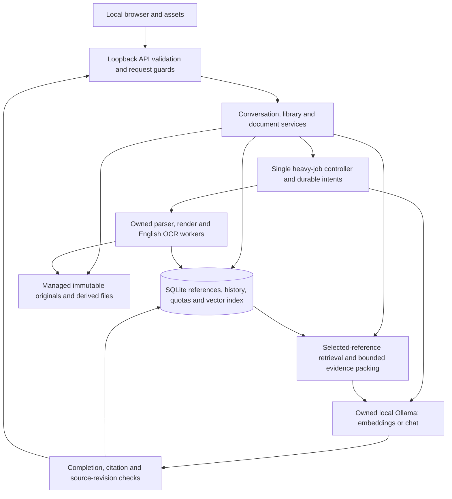

# ADR0001 — local modular document assistant

## Status

**T29 retrieval trace, 2026-11-20:** T28 commit `e9d5580`/CP10 acceptance and the explicit T29 instruction authorize scoped retrieval. Use the selected sqlite-vec native cosine function on canonical T28 BLOBs, constraining source bindings before scoring and retaining a stable five-element ranking heap. This avoids another persisted vector copy/virtual-table schema at this increment while preserving the chosen backend; the earlier MATCH timings are not performance evidence for this streaming scalar path. Full-scale/source-hash/native-call cost remains unvalidated. Immutable source snapshots, separate ranked/supplied sets, complete byte-bounded packing and post-query/ranking source checks implement R01 without inventing a support threshold. [Routine evidence](../benchmarks/t29-retrieval.md): 466 passed/one existing skip and warning, scoped Ruff passed, scope mutation caught/restored. Models/native kernel were injected. Exact native DLL bridge execution is prepared as separately gated T29-N1, not inferred from these tests. No dependency/schema/retention/adoption or stage change; T30 remains unstarted.

**T28 persistence trace, 2026-11-20:** after T27 repair/S2 commit `73cb659`, the user's continuation authorized versioned index persistence. Schema v5 uses the same SQLite transaction/quota envelope for canonical float32 vectors, per-extraction provenance bindings, omissions and scoped intents. Generation identity excludes source names/ownership while including all transform/embedding/storage versions. This permits content reuse without sharing display/citation identity. One publication transaction spans bounded embedding batches and verified teardown, trading a longer write transaction/cache pressure for atomic vector/metadata publication and existing rollback recovery. Frozen canonical BLOBs are persisted once; selected sqlite-vec query structures/loading/ranking remain T29, with no backend substitution, additional database or dependency. [Verification and CP10 review](../benchmarks/t28-indexing.md): 424 passed/one existing skip and warning, application/test Ruff passed, three process-exit boundaries and caught/restored space mutation. Embeddings were mocked in T28 integration; real-model persistence, native search, full-scale memory and answer quality remain unverified. No retention/readiness/stage change is adopted.

**T27-R1/S2 trace, 2026-11-20:** [S1](../benchmarks/t27-runtime-first-stop.md) stopped before native launch because diagnostics used a legacy manifest directory. The approved repair selects the exact installed Ollama 0.40.16 v2 path while retaining all identity/size/ancestry checks; an unbounded search or legacy fallback could obscure a provisioning mismatch. Safe component-specific errors and conservative pre-native reporting improve diagnosis without changing dependencies, model selection, schema, retention or G2. [Regression](../benchmarks/t27-preflight-correction.md): 387 passed/one existing skip and warning, Ruff passed. The operator then completed the separately sealed disconnected [S2 smoke](../benchmarks/t27-runtime-smoke-02.md): real embeddings, owned positive/cancellation cleanup and released port passed. Both allocations are preserved/closed; S1 receipts/seal are unchanged. T27 implementation/bounded integration verification is complete; final resource/quality acceptance and app readiness remain unchanged. Historical unexecuted wording below describes earlier implementation points.

**T27-D/E implementation trace, 2026-11-20:** after client commit `ae1f611`, the user's continuation authorized the owned-runtime adapter and smoke preparation. It uses the existing store's single work slot and stdlib Windows Job Objects, with atomic startup job assignment, explicit local environment, owned root/listener checks and bounded teardown. Atomic creation avoids a separate create/assign interval; retained staging homes avoid unapproved recursive deletion. No new dependency/model or broader trust boundary is selected. [Fake-only evidence](../benchmarks/t27-runtime-owner.md): 36 new cases, full suite 365 passed/one existing skip and warning, Ruff passed. Actual process/CPU/memory/offline behavior remains unverified until the separately approved [T27-S1 package](../proposals/t27-runtime-smoke.md); it has not run, readiness stays unchanged and the user approved the source commit and exact T27-S1 package on 2026-11-20; execution awaits operator offline confirmation. The G2 decision below is unchanged.

**Accepted at G2, 2026-11-20.** The user approved all presented items: this architecture/component/contract decision, the bounded T18 foundations scope and committing the reviewed documentation. [Approval record](../decisions.md#2026-11-20--g2-approved-t17-closed-bounded-t18-authorized). T17 is closed; T18 may proceed within its recorded limits. Ollama-internal tokenization is selected. The omitted selected-runtime/input-fit/16 GB investigations remain unverified limitations, with SPEC and normal implementation/acceptance tests unchanged. Earlier Proposed/pending statements below are historical.

**Latest component decision, 2026-11-20:** the user selected [Ollama's internal tokenizer](../decisions.md#2026-11-20--ollama-internal-tokenizer-selected), superseding standalone Hugging Face tokenization. No separate tokenizer graph is proposed for installation. Use ordinary Ollama chat/embedding requests; no private-port bridge/custom build is selected. Exact pre-request counting, output reservation and boundary handling remain unverified under the prior investigation omission. This component choice is approved; the complete architecture remains **Proposed pending G2 and T18 authorization**. Earlier route/status notes below are historical.

**Latest user decision, 2026-11-19 — ready for conditional G2 review:** the user accepted proceeding without the three remaining dependency-evidence, standalone/Ollama and 16 GB target-proof investigations. [Decision](../decisions.md#2026-11-19--stop-the-three-remaining-t17-investigations). B01–B03 remain unverified limitations; they no longer require another investigation before presenting this decision. Keep SPEC, target hardware, PDF/OCR limitations and normal implementation/acceptance tests intact. This ADR remains **Proposed pending G2 architecture/component adoption and T18 authorization**. No installation or application code is authorized by this status note alone. Older status notes below are historical.

**SV2 follow-up, 2026-11-19:** [Exact dependency findings](../benchmarks/t17-standalone-validation-closeout.md) verify the full seventeen-node graph, ten current registry/wheel identities and three exact publication subjects. These do not supply the remaining build-source/native-notice evidence. Installation and standalone/selected-Ollama parity remain blocked; B01–B03 and the Proposed G2 status are unchanged. No new architecture or runtime adoption follows from the user's work/commit authorization.

**User-selected counting direction, 2026-11-19:** standalone Hugging Face tokenization with pinned local assets is now the chosen route for input accounting; Ollama continues generation/embeddings. Retain the existing 0.23.3 candidate/full dependency graph for focused validation. [Decision](../decisions.md#2026-11-19--standalone-tokenizer-direction-selected). Route selection is settled; provisioning, exact selected-model parity and the overall G2 decision remain distinct. No runtime-readiness pass is inferred from popularity or local download alone.

**Consolidated evidence, 2026-11-19:** [T17 closeout](../benchmarks/t17-consolidated-closeout.md) records 21 new evaluation tests, 75 rehashed runtime files, complete model hashes, 11 successful packaged-reference count comparisons and fresh format/OCR component checks. It also identifies B01 (full selected-Ollama/standalone parity), B02 (physical 16 GB or approved proxy) and B03 (selected-runtime/standalone notice, provisioning and advisory closure). This ADR remains **Proposed; unconditional G2 is not ready**. No application implementation or adoption. Older status paragraphs below are historical.

**R1-W bounded source review:** approved proposal committed `780bad2`; [findings](../benchmarks/public-source-web-review.md) add selected advisory/fixed-version and notice evidence, but leave complete native/vendor freshness and exact input-fit validation open. Pinned Ollama source has truncation/rendering controls and an internal runner tokenizer; no stable application-facing exact count-only contract or template/token parity has been validated. Recommend a separate static preflight-integration design, with no new architecture/dependency/runtime adoption. This ADR remains Proposed and G2 open. Historical zero-HTTP wording below concerns the original failed helper.

**Research follow-up stopped before HTTP:** architecture pack committed `dbd9137`; approved R1attempt is closed with0requests/0sources because of local startup/close-adapter defects. [Stop report](../benchmarks/public-source-review-stop.md) preserves evidence and proposes a separate no-network integration repair. Nothing in this attempt resolves the freshness/input-fit/native-trust/resource gates below; G2 remains open.

**Proposed for G2; not accepted.** Prepared under user-approved T17-A1–A6 after readiness commit `e9d107e`. This is a concrete design/adoption pack, not application implementation. Settled SPEC/T16/T17 policy choices below are approved individually; they do not imply approval of this ADR, components or a native execution boundary. [Contracts](../contracts.md), [component inventory](../dependencies.md#t17-a1--static-reconciliation-and-proposed-runtime-set) and [provisioning gates](../provisioning.md#t17-static-pack--provisioning-and-validation-handoff) are part of the pack.

## Context

Stage1 must provide a local single-user browser app for PDF/XLSX/CSV attachments and a reusable library, including scanned/mixed-PDF English OCR, grounded answers/citations, saved conversations and honest support indicators. Target: Windows11,16GB RAM, CPU-only. User data/inference remain local. No multi-user authentication/RBAC/OAuth, external business actions, server deployment, desktop packaging or graph retrieval is included.

Component trials exist; no end-user application exists. Tiny synthetic successes, qualitative answer acceptance and measurements on an approximately19.911GiB machine do not establish full target-machine/representative-scale acceptance. T16 has reviewed scope/provenance/answer contracts; chart feasibility is explicitly deferred until after the first usable CSV flow/T34, not silently dropped.

## Proposed decision

**T25 implementation trace, 2026-11-20:** CSV normalization now streams typed per-column cell tables with record/column/physical-line context and explicit header/raw-offset limitations. Schema v4 adds reference-scoped requests, versioned generations and complete unit rows. For CSV, storing normalized cells in the existing SQLite database permits one atomic generation publication and journal rollback, avoiding another filesystem-promotion boundary. It retains the trade-off of a longer write transaction/cache pressure; per-unit growth reservation, the existing main/journal envelope, one heavy lease and yielding status reads bound the implemented path without claiming full-size/16-GB performance. Scoped escaped JSON previews reverify originals and disclose clipping; no citation-resolution or frontend framework is introduced. [Evidence and alternatives/limits](../benchmarks/t25-csv.md). No dependency, model, retention or stage change is adopted; future format-specific render/image storage and indexing remain separate tasks.

**T24 implementation trace, 2026-11-20:** the authorized batch/status task retains raw single-file streaming and adds a bounded idempotent JSON manifest with stable per-file IDs. Schema v3 adds manifests, file bindings and safe failure codes, migrating exact v1/v2 schemas. Shared transactional slot reservations coordinate queued batches with standalone upload admission; successful originals remain awaiting extraction. One unresolved cleanup still blocks admission while safe status reads remain available. This avoids multipart/base64/archive uploads, a new queue/worker framework or dependencies. [Contract, evidence and limitations](../benchmarks/t24-processing.md), including deliberate retry after verified cleanup, persistent queued slots without automatic expiry/cancellation and unverified full-size/target-machine performance. T25/extraction/index readiness and general lifecycle remain later tasks.

**T23 implementation trace, 2026-11-20:** the explicitly authorized single-CSV upload task connects the local HTTP boundary to immutable SHA256 originals and scoped references. Schema v2 adds upload intents/reservations and migrates an exact v1 database. OS root ownership, short serialized DELETE/FULL transactions, conservative database/journal reservations with enforced page ceilings, verified body replay and one interrupted-upload cleanup pass implement the accepted C01–C04 subset. This uses stdlib facilities and existing FastAPI; no multipart, ORM, worker framework or new dependency is introduced. Server UUIDs and stored labels remain separate from physical content identity. [Evidence and trade-offs](../benchmarks/t23-uploads.md), including conservative near-cap refusals, same-account filesystem limits and unverified full-size/target-machine performance. The T20 trace below records its earlier v1-only foundation; general lifecycle, batch/status and extraction remain later tasks.

**T20 implementation trace, 2026-11-20:** the explicitly authorized minimal C02 subset now uses stdlib SQLite schema v1: unique content SHA256 rows, separate document UUIDs, conversation UUIDs and scoped reference UUIDs. A null document owner denotes a library item; a non-null owner denotes an exclusive attachment. SQL constraints/triggers preserve that ownership and prevent duplicate or over-ten memberships; repeat library membership reuses its existing reference. Ownership changes/deletion are intentionally unavailable until the coordinated lifecycle is implemented. This avoids premature duplicate library/attachment schemas while retaining distinct visibility for identical content. DELETE/FULL transactions and exact schema/version checks implement the already accepted storage direction. No ORM/vector extension, public mutation API, ingestion or quota ledger is introduced. [Verification and limits](../benchmarks/t20-storage.md).

Use a modular FastAPI/Uvicorn application with a minimal locally served HTML/CSS/JavaScript frontend and HTTPX for a separately owned loopback Ollama process. Use one SQLite metadata/history database with the exact reviewed sqlite-vec extension for scoped embeddings; keep immutable originals, normalized extraction and previews in a managed application data root. Use a small number of cohesive modules only when their implementation task needs them, not a speculative skeleton.

Let the selected Ollama runtime perform model-native tokenization for chat and embeddings. The application does not install a standalone Hugging Face tokenizer or replace the model's internal tokenization. Keep request bounds and explicit error/termination handling; do not treat post-generation usage as proof of exact pre-admission fit. No new model/runner API is invented.

Prefer standard-library CSV, openpyxl for XLSX and one explicit pdfplumber/pdfminer text/layout/table path with reviewed PDFium rendering and Tesserocr/Tesseract English OCR. Keep pypdf and RapidOCR as historical evaluation alternatives, not automatic runtime fallback chains. Prefer pinned Nomic embeddings and Qwen2.5 1.5B chat from the approved shortlist. Exact artifact/license/prefix/version identity is in the inventory; tags alone are insufficient. These are proposed G2 selections, not new installed dependencies.

Browser input/model output/extracted text are untrusted; server-owned IDs, validated references and the supplied-evidence manifest define scope. The browser never accesses the database, model store or filesystem directly. Workers return bounded typed results; they do not accept model-generated commands or arbitrary paths. Native worker process jobs/timeouts are resource/ownership controls, not filesystem confinement. A concrete native trust boundary still needs explicit adoption review; prior synthetic no-confinement permission does not cover private-document application execution.

## Contracts and policies carried forward

- **C01 local/network:** proposed loopback ports/data root, same-origin Host/Origin/anti-CSRF and locally served sanitized previews; no cloud, proxy/redirect escape, global service attachment or startup downloads.
- **C02 identity/storage:** originals separate from versioned extraction; logical document/reference ownership separate from content hashes; one transactional metadata/vector store; ready-generation promotion and no cross-conversation dedup leakage.
- **C03 quotas:** decimal100MB/file,10references/upload/conversation,1GB unique library originals,10GB conversation-only originals,5GB processed including database/history/retained journals,1GB temporary including staging/render scratch/copies. Reserve before writes/expansion; no silent eviction or automatic compaction. Exact growth/class-transition implementation remains a review/validation obligation.
- **C04/C05 lifecycle:** unique idempotency intent before effects, payload verification, pending/unknown outcomes, coordinated answer-publication/version checks and durable deletion before exclusive physical cleanup; preserve shared/library bytes and block referenced-library removal. The user approved minimal content-free tombstones until an explicitly approved maintenance policy removes them; count them against5GB and purge deleted text/paths/fingerprints once cleanup no longer requires them.
- **C06 API:** concrete route/error/ID/pagination/async-operation contracts, proposed names/defaults; safe error text and no private paths; no new multipart/ORM/frontend dependency is assumed.
- **C07 resources:** user-approved validation targets are one heavy job, warm complete answer≤30s,90s hard answer timeout, total owned processes≤8GiB and physical availability≥4GiB. No observed result is inferred. R01 remains a provisional2048-context/192-output and byte-bounded packing baseline pending trustworthy fit and multi-file checks.
- **C08 evidence/quality:** use only actually supplied scoped sources, distinguish structural citation checks from semantic support, retain initial hard gates/aggregate targets and fixed denominators. Chart Q18/Q19 remain deferred/unready definitions, not excluded or passing. No calibrated correctness percentage.

## Alternatives and trade-offs

| Choice | Alternative considered | Reason for proposal / limit |
|---|---|---|
| Minimal local browser/backend | Frontend framework, desktop wrapper or multi-service deployment | Approved simple UI direction; fewer build/runtime dependencies. UI UX Pro Max review still precedes actual frontend work |
| SQLite + sqlite-vec | SQLite/Python exhaustive baseline | Matching tested rankings/recovery and lower paired1000-vector median282ms versus478ms; larger DB/update costs and native artifact limitations remain; no10k scaling result |
| One explicit PDF path | Multiple automatic parser/OCR fallback chains | Preserve provenance/failures and avoid doubled work/ambiguous outputs. Representative reading-order, scan detection and rotation support remain unresolved acceptance items |
| Nomic + small Qwen | EmbeddingGemma/Qwen3 or larger models | Recorded shortlist/resource/latency trade-offs; no general quality advantage or final speed guarantee. No silent model replacement |
| Serialized heavy work | Parallel parsing/OCR/indexing/generation | Lower simultaneous pressure on16GB CPU target, simpler ordering; busy operations must be visible and long jobs must remain bounded |
| Durable intent + pending cleanup | Synchronous all-or-nothing file/database deletion | Filesystem and SQLite have no shared atomic transaction; explicit reconciliation is more honest and preserves shared ownership, at the cost of pending-state complexity |

## T17-A5 static review and design traces

| Trace | Required invariant / outcome from the written contracts |
|---|---|
| Two identical uploads in different chats | Stored bytes/index work may deduplicate; distinct references, count limits and retrieval/history/preview membership still apply |
| Same idempotency key, concurrent retries | Unique SQLite claim admits one intent; verified payload mismatch conflicts; unknown outcome is not silently retried |
| Quota fills during extraction/rebuild | Reservation precedes each bounded write/expansion; leave prior ready generation intact; retain failed/pending charges until owned cleanup verifies removal |
| Library removed while a chat uses it |409reference block; no content/quotations silently removed; proposed class transition cannot evade the conversation-original cap |
| Deletion races with generation/new reference | Commit unavailable state/intent before cleanup; serialize content operations and atomically validate revision during publication; no stale answer or newly referenced-file deletion |
| Worker crash or source unexpectedly missing | Reconcile durable intent under bounded recovery; no premature cleanup-success claim. Retained old answer is labelled unavailable and excluded from new evidence |
| Top5 contains both required files but packing drops one | Pre-packing retrieval can pass; supplied-evidence coverage/complete-answer success cannot. Unpacked candidate IDs are invalid citations |
| Citation resolves but claim is unsupported | Structural indicator cannot promise semantic verification; internal human claim/citation scoring detects the unsupported conclusion |
| Missing model/OCR asset, unsafe output or overlong context | Refuse safely; no implicit download, shell/path/HTML execution, proxy/cloud fallback or silent token truncation |

This is a static walkthrough, not an independent runtime reviewer or passing concurrency/OCR/model test. Source/gold/lock/assets remain unchanged. Routine future tests mock Ollama; real resource/network/fit/recovery checks need separately approved bounded execution.

## Readiness matrix and blockers

| Gate | Current disposition | Evidence / exact remaining work |
|---|---|---|
| Settled scope/policies | Recorded | SPEC/T16 plus explicit T17 accounting/original-cap/resource/tombstone decisions; no repeated approval needed for unchanged choices |
| Concrete architecture/contracts | Accepted at G2, 2026-11-20 | This ADR/C01–C08/API/identity/transaction/quota/privacy designs approved with the explicitly recorded unverified limitations. |
| Artifact/runtime inventory | Ollama-native route selected; further selected-runtime B03 investigation omitted by user decision | The standalone graph is no longer proposed for installation. Its ten-wheel/seventeen-node review is historical evidence. Remaining selected-runtime notice/security limitations stay disclosed. |
| Model-input fit | Internal tokenization selected; further B01 investigation omitted by user decision | 21 tests, model metadata and 11 packaged-reference count matches retain their limits. Standalone parity is no longer an adoption prerequisite; exact application pre-request fit and output/equality semantics remain unverified. |
| Resource/target-machine feasibility | Larger-host observations retained; further B02 proof omitted by user decision | About19.91GiB host observations do not prove the unchanged 16 GB target. No proxy, full-answer or whole-application guarantee is inferred. |
| Parser/OCR representative acceptance | Fresh small format/OCR gold checks plus historical evidence | CSV/XLSX/mixed PDF/render/OCR checks passed; rotation/layout/scale and future product integration remain explicit |
| Product integration | Future implementation/acceptance | CSV-first upload→grounded answer→citations→saved chat/restart, then PDF/OCR/XLSX slices; these cannot be claimed before coding |
| Chart timing | Explicit deferral recorded | T16A after T34 before chart adoption/claims; does not waive other format/OCR/privacy requirements |
| G2 and T18 implementation | **G2 accepted; bounded T18 authorized** | Explicit approval recorded on 2026-11-20; T17 closed. Normal implementation/Stage 1 acceptance and later-package/stage gates remain. |

## Follow-up boundaries and requested review

Present one G2 decision on the existing proposed stack and C01–C08 contracts, with B01–B03 explicitly unverified under the user's decision above. Do not start another source-refresh, parity or target-machine trial as an automatic prerequisite. Existing stopped/completed runs remain closed. Any future trial would need its own applicable scope and execution boundary.

Do not build a placeholder app to obscure these gaps. Do not require a completed end-user app as proof before approving any implementation: distinguish component/adoption readiness above from product integration tests that correctly follow G2. Bring unresolved component feasibility/privacy/fit/resource decisions to the user; do not silently reduce approved limits or defer them under the chart timing exception.

G2 component/contract adoption and the bounded T18 authorization are now recorded. T18 reuses the existing local baseline and verifies the foundations needed for implementation. This acceptance does not authorize new dependencies, downloads, a model trial or another development stage outside that task's scope. Later runtime integration must retain the recorded limitations and actual acceptance evidence.
